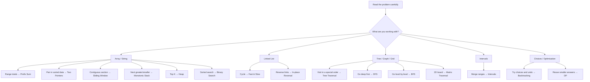
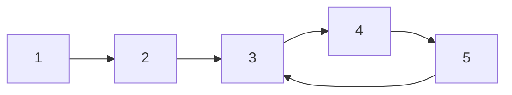
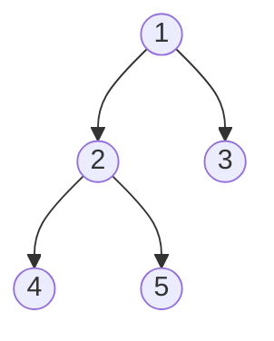

# DSA Made Simple: 15 LeetCode Patterns

## A beginner-friendly, in-depth guide with Python examples

> **Big idea:** You do not need to memorise thousands of solutions. Learn a smaller set of problem-solving patterns, understand why they work, and practise recognising when to use them.

This guide explains each pattern in two layers:
- **Simple idea:** an everyday analogy that makes the concept easy to picture.
- **Technical understanding:** the actual algorithm, Python template, complexity, and common mistakes.

The analogies are only learning aids. The code and algorithm sections explain the real computer-science idea.

**Based on:** Ashish Pratap Singh, *LeetCode was HARD until I Learned these 15 Patterns* (July 21, 2024).  
**Expanded with:** beginner explanations, Python templates, complexity notes, recognition clues, and interview tips.

---

# How to use this guide

For every pattern, follow this routine:

1. Read the simple explanation.
2. Understand the example by tracing it with your finger.
3. Read the algorithm steps.
4. Type the Python code yourself. Do not just copy it.
5. Change the input and predict the output before running it.
6. Solve the practice problems from easiest to hardest.
7. Explain out loud why this pattern fits the problem.

## The 15 patterns at a glance

| # | Pattern | Think of it as… | Look for… |
|---:|---|---|---|
| 1 | Prefix Sum | Keeping a running shopping bill | Range sums, cumulative totals |
| 2 | Two Pointers | Two people searching from opposite ends | Sorted arrays, pairs |
| 3 | Sliding Window | A small frame sliding over a row | Contiguous subarrays/substrings |
| 4 | Fast & Slow Pointers | A slow walker and a fast runner | Cycles in linked lists |
| 5 | Linked List Reversal | Turning a line of arrows around | Reversing linked-list links |
| 6 | Monotonic Stack | Waiting for the next taller person | Next greater/smaller element |
| 7 | Top K Elements | Keeping only the best K players | Kth largest, top-K frequency |
| 8 | Overlapping Intervals | Joining overlapping time bookings | Ranges that overlap |
| 9 | Modified Binary Search | Searching a partly rotated book shelf | Sorted or rotated search spaces |
| 10 | Binary Tree Traversal | Visiting every room in a tree-shaped house | Visit order |
| 11 | DFS | Exploring one corridor fully first | Paths, connected components |
| 12 | BFS | Visiting all nearby rooms before going farther | Levels, unweighted shortest path |
| 13 | Matrix Traversal | Exploring connected squares on a board | Grids, islands, flood fill |
| 14 | Backtracking | Trying a choice, then undoing it | All combinations/permutations |
| 15 | Dynamic Programming | Saving answers to avoid doing work twice | Repeated subproblems, best answer |

## A simple decision map



---

# 1. Prefix Sum

## The simple idea

Imagine you are buying toys. You write down the total amount you have spent after each toy. If someone asks, “How much did you spend on toys 2 to 4?”, you do not add every price again. You subtract the total before toy 2 from the total after toy 4.

That is a **Prefix Sum**.

## What it means technically

A prefix-sum array stores the running total from the beginning of the input array up to each position.

Example:

```text
Numbers:      [1, 2, 3, 4, 5, 6]
Prefix sums:  [1, 3, 6, 10, 15, 21]
```

The prefix sum at index `3` is `1 + 2 + 3 + 4 = 10`.

## When should you think of it?

- The problem asks for sums between two indexes.
- There are many range-sum queries.
- You need running or cumulative totals.
- The same part of an array would otherwise be added repeatedly.

## Example, step by step

Find the sum from index `1` to index `3` (both ends included).

```text
Numbers:      [1, 2, 3, 4, 5, 6]
Indexes:       0  1  2  3  4  5
Prefix sums:  [1, 3, 6,10,15,21]
```

The answer is `2 + 3 + 4 = 9`.

```text
prefix[3] - prefix[0]
      10  -     1  = 9
```

For a range starting at index `0`, there is no earlier prefix to subtract. Handle that case separately, or use the common extra-zero technique below.

## Python template

```python
def build_prefix_sum(nums):
    prefix = [0]  # extra zero makes range calculations easier

    for number in nums:
        prefix.append(prefix[-1] + number)

    return prefix


def range_sum(prefix, left, right):
    # Both left and right are included.
    return prefix[right + 1] - prefix[left]


nums = [1, 2, 3, 4, 5, 6]
prefix = build_prefix_sum(nums)

print(prefix)                 # [0, 1, 3, 6, 10, 15, 21]
print(range_sum(prefix, 1, 3)) # 9
```

## Why does this work?

`prefix[right + 1]` contains everything from the beginning through `right`.  
`prefix[left]` contains everything before `left`.  
Subtracting removes the unwanted earlier part and leaves only the requested range.

## Complexity

- Build prefix sums: **O(n)** time.
- Each range query: **O(1)** time.
- Extra space: **O(n)**.

## Common mistakes

- Forgetting whether the right endpoint is included.
- Mixing zero-based indexes with one-based positions.
- Forgetting the special case where the range starts at index `0`.
- Using prefix sums when the problem needs a different kind of range operation.

## Practice

- [303. Range Sum Query - Immutable](https://leetcode.com/problems/range-sum-query-immutable/)
- [525. Contiguous Array](https://leetcode.com/problems/contiguous-array/)
- [560. Subarray Sum Equals K](https://leetcode.com/problems/subarray-sum-equals-k/)

---

# 2. Two Pointers

## The simple idea

Imagine two children standing at opposite ends of a line of numbered boxes. They look at the numbers and move closer until they find two numbers that add up to the target.

Those two children are the **two pointers**.

## What it means technically

Two indexes move through a sequence. In the common sorted-array version:
- `left` starts at the beginning.
- `right` starts at the end.
- Their values tell us which pointer should move.

## When should you think of it?

- You need a pair of values.
- The array is sorted, or sorting is allowed.
- You need to compare values from two ends.
- You want to avoid checking every possible pair.

## Example

Find two values that add up to `6`.

```text
nums = [1, 2, 3, 4, 6]
target = 6
```

```text
Step 1:  left=1, right=6 → sum=7 (too big)
        Move right left.

Step 2:  left=1, right=4 → sum=5 (too small)
        Move left right.

Step 3:  left=2, right=4 → sum=6 (found!)
```

## Python template

```python
def two_sum_sorted(nums, target):
    left = 0
    right = len(nums) - 1

    while left < right:
        current_sum = nums[left] + nums[right]

        if current_sum == target:
            return [left, right]
        elif current_sum < target:
            left += 1
        else:
            right -= 1

    return []
```

## Why can we safely move a pointer?

The array is sorted.

- If the sum is too small, using the current left value with an even smaller right-side value cannot help. Move `left` to a larger value.
- If the sum is too large, using the current right value with an even larger left-side value cannot help. Move `right` to a smaller value.

This reasoning depends on sorted order. It does not automatically work on an unsorted array.

## Complexity

- Time: **O(n)** because each pointer moves at most `n` times.
- Extra space: **O(1)**.

## Common mistakes

- Using this exact movement rule on an unsorted array.
- Writing `left <= right` when the task needs two different elements.
- Moving the wrong pointer.
- Forgetting that some problems ask for values while others ask for indexes.

## Practice

- [167. Two Sum II - Input Array Is Sorted](https://leetcode.com/problems/two-sum-ii-input-array-is-sorted/)
- [15. 3Sum](https://leetcode.com/problems/3sum/)
- [11. Container With Most Water](https://leetcode.com/problems/container-with-most-water/)

---

# 3. Sliding Window

## The simple idea

Imagine a toy train with three windows. You want to count the toys visible through the windows. Instead of rebuilding the whole train view each time, slide the window one step:
- One toy leaves.
- One new toy enters.

That moving frame is a **Sliding Window**.

## What it means technically

A window is a continuous section of an array or string. We maintain information about that section while moving its boundaries.

Two common versions:
- **Fixed-size window:** the window always contains `k` elements.
- **Variable-size window:** expand or shrink the window to satisfy a condition.

## When should you think of it?

- The question says subarray or substring.
- Elements must be next to each other (contiguous).
- It asks for a maximum, minimum, longest, or shortest continuous section.
- A window can be updated instead of recalculated from scratch.

## Example: maximum sum of 3 neighbouring numbers

```text
nums = [2, 1, 5, 1, 3, 2]
k = 3
```

```text
[2, 1, 5]  1, 3, 2  → sum = 8
 2, [1, 5, 1], 3, 2 → sum = 7
 2, 1, [5, 1, 3], 2 → sum = 9  ← best
 2, 1, 5, [1, 3, 2] → sum = 6
```

## Python template: fixed-size window

```python
def max_sum_window(nums, k):
    if k <= 0 or k > len(nums):
        return None

    window_sum = sum(nums[:k])
    best_sum = window_sum

    for right in range(k, len(nums)):
        window_sum += nums[right]       # new value enters
        window_sum -= nums[right - k]   # old value leaves
        best_sum = max(best_sum, window_sum)

    return best_sum


print(max_sum_window([2, 1, 5, 1, 3, 2], 3))  # 9
```

## Variable-size window: the general shape

```python
left = 0

for right in range(len(nums)):
    # Add nums[right] to the current window.

    while window_is_invalid:
        # Remove nums[left] from the current window.
        left += 1

    # Update the answer using the valid window.
```

The exact condition depends on the problem. Do not copy `window_is_invalid` literally; replace it with the real rule.

## Complexity

For the fixed-size example:
- Time: **O(n)**.
- Extra space: **O(1)**.

A typical variable-size sliding window is also O(n) when each pointer only moves forward and each element enters/leaves the window a limited number of times.

## Common mistakes

- Using a window for values that do not need to be contiguous.
- Forgetting to remove the element that leaves the window.
- Updating the answer before the window is valid.
- Assuming every variable-size window works with negative numbers. Some sum-based shrinking rules rely on non-negative values.

## Practice

- [643. Maximum Average Subarray I](https://leetcode.com/problems/maximum-average-subarray-i/)
- [3. Longest Substring Without Repeating Characters](https://leetcode.com/problems/longest-substring-without-repeating-characters/)
- [76. Minimum Window Substring](https://leetcode.com/problems/minimum-window-substring/)

---

# 4. Fast & Slow Pointers

## The simple idea

Imagine two runners on a circular running track. One runs slowly and the other runs twice as fast. If the track is a loop, the fast runner will eventually catch the slow runner.

This is the **Fast & Slow Pointers** pattern, also called **Tortoise and Hare**.

## What it means technically

Two references move through a linked list at different speeds:
- `slow` moves one node at a time.
- `fast` moves two nodes at a time.

If there is a cycle, they eventually meet. If `fast` reaches the end, there is no cycle.

## When should you think of it?

- Detecting a cycle in a linked list.
- Finding the middle of a linked list.
- Some problems that repeatedly transform a value and need cycle detection.

## Visual idea



The arrow from `5` back to `3` makes a loop.

## Python template

This is LeetCode's usual linked-list-node style:

```python
def has_cycle(head):
    slow = head
    fast = head

    while fast is not None and fast.next is not None:
        slow = slow.next
        fast = fast.next.next

        if slow is fast:
            return True

    return False
```

`is` checks whether both variables point to the same node object. That is what cycle detection needs.

## Complexity

- Time: **O(n)**.
- Extra space: **O(1)**.

## Common mistakes

- Checking `fast.next.next` before confirming `fast` and `fast.next` exist.
- Comparing node values instead of node identity.
- Moving `fast` only one step by accident.
- Forgetting that an empty list has no cycle.

## Practice

- [141. Linked List Cycle](https://leetcode.com/problems/linked-list-cycle/)
- [202. Happy Number](https://leetcode.com/problems/happy-number/)
- [287. Find the Duplicate Number](https://leetcode.com/problems/find-the-duplicate-number/)

---

# 5. Linked List In-place Reversal

## The simple idea

Imagine a row of toy cars connected by arrows. The arrows point to the next car. You want the cars to stay where they are, but make every arrow point in the opposite direction.

You change the arrows one by one. You do not need to build a second row of cars.

That is **in-place linked-list reversal**.

## What it means technically

A linked-list node stores a value and a reference to the next node. Reversal changes the `next` references so the list order is reversed.

## When should you think of it?

- Reverse an entire linked list.
- Reverse a section between positions `m` and `n`.
- Reverse nodes in groups or swap neighbouring nodes.

## Example

```text
Before: 1 → 2 → 3 → 4 → 5 → None
After:  5 → 4 → 3 → 2 → 1 → None
```

## Python template: reverse the whole list

```python
def reverse_list(head):
    previous = None
    current = head

    while current is not None:
        next_node = current.next  # remember the rest of the list
        current.next = previous   # turn this arrow backwards
        previous = current        # move previous forward
        current = next_node       # move to the saved next node

    return previous
```

## Why do we need three references?

- `previous`: the part we have already reversed.
- `current`: the node we are changing now.
- `next_node`: the remaining list, saved so we do not lose it.

If you change `current.next` before saving the original next node, you can lose access to the rest of the list.

## Complexity

- Time: **O(n)**.
- Extra space: **O(1)**.

## Common mistakes

- Forgetting to save `current.next`.
- Returning `head` instead of the new head (`previous`).
- Accidentally creating a cycle.
- Losing the unreversed part of the list.

## Practice

- [206. Reverse Linked List](https://leetcode.com/problems/reverse-linked-list/)
- [92. Reverse Linked List II](https://leetcode.com/problems/reverse-linked-list-ii/)
- [24. Swap Nodes in Pairs](https://leetcode.com/problems/swap-nodes-in-pairs/)

---

# 6. Monotonic Stack

## The simple idea

Imagine children standing in a line. Each child wants to know: “Who is the first taller child to my right?”

A stack helps us keep track of children who are still waiting for their answer. When a taller child arrives, some children finally get their answer.

That is the idea behind a **Monotonic Stack**.

## What it means technically

A stack is kept in sorted order:
- Increasing monotonic stack: values follow an increasing order.
- Decreasing monotonic stack: values follow a decreasing order.

When a new value breaks that order, we pop items and resolve their answers.

## When should you think of it?

- Next greater element.
- Next smaller element.
- Daily temperatures.
- Largest rectangle in a histogram.

## Example: next greater element

```text
Numbers:      [2, 1, 2, 4, 3]
Next greater: [4, 2, 4, -1, -1]
```

For `2` at index `0`, the first bigger value to its right is `4`.  
For `1`, the first bigger value to its right is `2`.  
For `4`, no bigger value appears, so the answer is `-1`.

## Python template: next greater element to the right

```python
def next_greater_elements(nums):
    result = [-1] * len(nums)
    stack = []  # stores indexes whose answer is not known yet

    for i, value in enumerate(nums):
        while stack and nums[stack[-1]] < value:
            old_index = stack.pop()
            result[old_index] = value

        stack.append(i)

    return result


print(next_greater_elements([2, 1, 2, 4, 3]))
# [4, 2, 4, -1, -1]
```

## Why store indexes instead of values?

We need to know which position in `result` should receive the answer. An index gives us both the position and access to the original value.

## Complexity

- Time: **O(n)**. Each index is pushed once and popped at most once.
- Extra space: **O(n)**.

## Common mistakes

- Choosing the wrong comparison (`<` versus `<=`) when duplicates matter.
- Forgetting that unresolved elements keep the default answer `-1`.
- Confusing “next greater” with “largest greater”.
- Storing values when the result needs original positions.

## Practice

- [496. Next Greater Element I](https://leetcode.com/problems/next-greater-element-i/)
- [739. Daily Temperatures](https://leetcode.com/problems/daily-temperatures/)
- [84. Largest Rectangle in Histogram](https://leetcode.com/problems/largest-rectangle-in-histogram/)

---

# 7. Top K Elements

## The simple idea

Imagine a sports competition with 100 players. You only want to keep the top 3 scores. You do not need to keep sorting every player after every new score. Keep a small group of the best 3 and remove the weakest member whenever a better player arrives.

That is the **Top K** idea.

## What it means technically

A heap (priority queue) lets us repeatedly access the smallest or largest item efficiently.

For the kth largest value, a **min-heap of size k** is useful:
- Keep at most `k` values.
- The smallest value among those kept is the kth largest overall.

## When should you think of it?

- Find kth largest or kth smallest.
- Find the top K frequent items.
- Keep the best K items from a large stream.

## Example

```text
nums = [3, 2, 1, 5, 6, 4]
k = 2
Answer = 5
```

The two largest values are `6` and `5`. The smaller of those two is `5`, so the second largest is `5`.

## Python template

```python
import heapq

def kth_largest(nums, k):
    heap = []

    for value in nums:
        heapq.heappush(heap, value)

        if len(heap) > k:
            heapq.heappop(heap)

    return heap[0]


print(kth_largest([3, 2, 1, 5, 6, 4], 2))  # 5
```

## Complexity

For `n` numbers and a heap of size `k`:
- Time: **O(n log k)**.
- Extra space: **O(k)**.

## Common mistakes

- Using a min-heap when the task requires a different ordering without adjusting the approach.
- Forgetting to keep the heap size at `k`.
- Returning the largest heap element instead of the root for this min-heap method.
- Not checking whether `k` is valid.

## Practice

- [215. Kth Largest Element in an Array](https://leetcode.com/problems/kth-largest-element-in-an-array/)
- [347. Top K Frequent Elements](https://leetcode.com/problems/top-k-frequent-elements/)
- [373. Find K Pairs with Smallest Sums](https://leetcode.com/problems/find-k-pairs-with-smallest-sums/)

---

# 8. Overlapping Intervals

## The simple idea

Imagine you have party bookings:
- Party A: 1 o'clock to 3 o'clock.
- Party B: 2 o'clock to 6 o'clock.

They overlap, so together they cover 1 o'clock to 6 o'clock.

This is the **Overlapping Intervals** pattern.

## What it means technically

An interval is a range such as `[start, end]`. After sorting intervals by start time, compare each interval with the last interval in the merged result.

For `[a, b]` and `[c, d]`, where the first starts earlier, they overlap when `c <= b` (for closed intervals).

## When should you think of it?

- Merge meeting times.
- Combine overlapping ranges.
- Find conflicts.
- Remove the minimum number of intervals to avoid overlap.

## Example

```text
Input:  [[1, 3], [2, 6], [8, 10], [15, 18]]
Output: [[1, 6], [8, 10], [15, 18]]
```

```text
[1---3]
  [2------6]  → [1-------6]

[8---10]      → stays separate
[15----18]    → stays separate
```

## Python template

```python
def merge_intervals(intervals):
    if not intervals:
        return []

    intervals.sort(key=lambda item: item[0])
    merged = [intervals[0]]

    for start, end in intervals[1:]:
        last_end = merged[-1][1]

        if start <= last_end:
            merged[-1][1] = max(last_end, end)
        else:
            merged.append([start, end])

    return merged


print(merge_intervals([[1, 3], [2, 6], [8, 10], [15, 18]]))
# [[1, 6], [8, 10], [15, 18]]
```

## Complexity

- Sorting: **O(n log n)**.
- Merging after sorting: **O(n)**.
- Overall: **O(n log n)** time.
- Extra space: depends on the sorting implementation and output; the merged result can hold up to `n` intervals.

## Common mistakes

- Forgetting to sort first.
- Comparing with the wrong interval.
- Updating the end to the current end without taking the maximum.
- Confusing touching endpoints with overlap. Follow the problem's exact definition.

## Practice

- [56. Merge Intervals](https://leetcode.com/problems/merge-intervals/)
- [57. Insert Interval](https://leetcode.com/problems/insert-interval/)
- [435. Non-overlapping Intervals](https://leetcode.com/problems/non-overlapping-intervals/)

---

# 9. Modified Binary Search

## The simple idea

Imagine looking for a name in a dictionary. You do not start at the first page. You open the middle:
- If the name you want comes earlier, look in the first half.
- If it comes later, look in the second half.

You keep cutting the search area in half. That is **Binary Search**.

Modified Binary Search uses the same clever idea when the data has an extra twist, such as being rotated.

## What it means technically

In a sorted array, binary search checks the middle element and discards half the remaining search space. In a rotated sorted array, one half is still sorted, so we identify that half and decide whether the target belongs there.

## When should you think of it?

- The input is sorted.
- The input is rotated but was originally sorted.
- The problem asks for a boundary, minimum, or target in an ordered search space.

## Example

```text
nums = [4, 5, 6, 7, 0, 1, 2]
target = 0
Answer index = 4
```

At each step:
1. Find `mid`.
2. Check whether the left half or right half is sorted.
3. Decide whether the target can be inside that sorted half.
4. Discard the half that cannot contain the target.

## Python template: search in a rotated sorted array

```python
def search_rotated(nums, target):
    left = 0
    right = len(nums) - 1

    while left <= right:
        mid = (left + right) // 2

        if nums[mid] == target:
            return mid

        # Left half is sorted.
        if nums[left] <= nums[mid]:
            if nums[left] <= target < nums[mid]:
                right = mid - 1
            else:
                left = mid + 1

        # Otherwise, right half is sorted.
        else:
            if nums[mid] < target <= nums[right]:
                left = mid + 1
            else:
                right = mid - 1

    return -1
```

## Complexity

- Time: **O(log n)** for this distinct-values rotated-array version.
- Extra space: **O(1)**.

## Common mistakes

- Using the wrong inclusive/exclusive boundary.
- Forgetting that one half is sorted, not necessarily the whole array.
- Incorrectly deciding whether the target belongs in the sorted half.
- Assuming duplicate values behave exactly like distinct values.

## Practice

- [33. Search in Rotated Sorted Array](https://leetcode.com/problems/search-in-rotated-sorted-array/)
- [153. Find Minimum in Rotated Sorted Array](https://leetcode.com/problems/find-minimum-in-rotated-sorted-array/)
- [240. Search a 2D Matrix II](https://leetcode.com/problems/search-a-2d-matrix-ii/)

**Note:** The source article groups *Search a 2D Matrix II* with this topic. That problem is commonly solved using an ordered-matrix search starting from a corner; it is not the same rotated-array technique shown in the code above.

---

# 10. Binary Tree Traversal

## The simple idea

Imagine a family tree. You want to visit every person, but you need to decide the order:
- Visit the parent first?
- Visit the left branch first?
- Visit the right branch first?

A **tree traversal** is simply a rule for visiting every node.

## What it means technically

A binary tree node can have a left child and a right child. The three depth-first traversal orders are:

- **Preorder:** Root → Left → Right
- **Inorder:** Left → Root → Right
- **Postorder:** Left → Right → Root

## Visual example



For this tree:

```text
        1
       / \
      2   3
     / \
    4   5
```

| Traversal | Visit order |
|---|---|
| Preorder | 1, 2, 4, 5, 3 |
| Inorder | 4, 2, 5, 1, 3 |
| Postorder | 4, 5, 2, 3, 1 |

## Python template: all three recursive forms

```python
def preorder(node):
    if node is None:
        return
    print(node.val)       # Root
    preorder(node.left)   # Left
    preorder(node.right)  # Right


def inorder(node):
    if node is None:
        return
    inorder(node.left)    # Left
    print(node.val)       # Root
    inorder(node.right)   # Right


def postorder(node):
    if node is None:
        return
    postorder(node.left)  # Left
    postorder(node.right) # Right
    print(node.val)       # Root
```

## Complexity

- Time: **O(n)** because every node is visited once.
- Extra space: **O(h)** recursion stack, where `h` is tree height. In a very unbalanced tree, this can become O(n).

## Common mistakes

- Mixing up the three orders.
- Forgetting the base case (`node is None`).
- Confusing tree traversal with graph traversal. Graphs may contain cycles, so they usually need a `visited` set.

## Practice

- [257. Binary Tree Paths](https://leetcode.com/problems/binary-tree-paths/)
- [230. Kth Smallest Element in a BST](https://leetcode.com/problems/kth-smallest-element-in-a-bst/)
- [124. Binary Tree Maximum Path Sum](https://leetcode.com/problems/binary-tree-maximum-path-sum/)

---

# 11. Depth-First Search (DFS)

## The simple idea

Imagine exploring a maze. You choose one corridor and keep walking until you cannot go farther. Then you walk back to the last place where another corridor was available.

That is **Depth-First Search**, or **DFS**.

## What it means technically

DFS explores one branch as deeply as possible before backtracking. It can be implemented with:
- Recursion (the program's call stack).
- An explicit stack.

## When should you think of it?

- Explore paths in a tree or graph.
- Find connected components.
- Check reachability.
- Explore all nodes reachable from a starting node.

## Example: root-to-leaf paths

```text
        1
       / \
      2   3
       \
        5
```

The paths are:

```text
1 → 2 → 5
1 → 3
```

## Python template: graph DFS

```python
def dfs(graph, start):
    visited = set()
    result = []

    def visit(node):
        if node in visited:
            return

        visited.add(node)
        result.append(node)

        for neighbour in graph[node]:
            visit(neighbour)

    visit(start)
    return result


graph = {
    "A": ["B", "C"],
    "B": ["A", "D"],
    "C": ["A"],
    "D": ["B"]
}

print(dfs(graph, "A"))
```

The exact output order depends on the order of neighbours in the graph.

## Complexity

For an adjacency-list graph:
- Time: **O(V + E)**, where `V` is vertices and `E` is edges.
- Extra space: **O(V)** for visited data and the recursion/stack in the worst case.

## Common mistakes

- Forgetting a `visited` set in a graph with cycles.
- Marking nodes too late, which can cause repeated work.
- Going too deep with recursion on a very large graph.
- Assuming DFS automatically finds the shortest path in an unweighted graph. BFS is usually the right choice for that.

## Practice

- [133. Clone Graph](https://leetcode.com/problems/clone-graph/)
- [113. Path Sum II](https://leetcode.com/problems/path-sum-ii/)
- [210. Course Schedule II](https://leetcode.com/problems/course-schedule-ii/)

---

# 12. Breadth-First Search (BFS)

## The simple idea

Imagine dropping a pebble into a pond. The ripples reach the closest places first, then places a little farther away.

BFS explores nearby nodes first, then moves outward. It visits **level by level**.

## What it means technically

BFS uses a **queue** (first in, first out):
1. Put the starting node into the queue.
2. Remove the first node.
3. Visit its unvisited neighbours and add them to the queue.
4. Continue until the queue is empty.

## When should you think of it?

- Level-order traversal in a tree.
- Shortest path in an unweighted graph.
- Minimum number of moves when every move has equal cost.

## Example: level-order traversal

```text
        3
       / \
      9   20
          / \
         15  7
```

BFS visits:

```text
Level 0: [3]
Level 1: [9, 20]
Level 2: [15, 7]
```

Output:

```text
[[3], [9, 20], [15, 7]]
```

## Python template: BFS

```python
from collections import deque

def bfs(graph, start):
    visited = {start}
    queue = deque([start])
    result = []

    while queue:
        node = queue.popleft()
        result.append(node)

        for neighbour in graph[node]:
            if neighbour not in visited:
                visited.add(neighbour)
                queue.append(neighbour)

    return result
```

Mark a node as visited when you add it to the queue. This prevents the same node being added many times.

## Complexity

For an adjacency-list graph:
- Time: **O(V + E)**.
- Extra space: **O(V)** for the queue and visited set.

## Common mistakes

- Using `list.pop(0)` for a queue in Python; it is inefficient. Use `collections.deque`.
- Forgetting `visited`.
- Marking a node visited only after removing it from the queue.
- Assuming BFS gives a weighted graph's cheapest path when edge costs differ. Ordinary BFS is for equal-cost edges.

## Practice

- [102. Binary Tree Level Order Traversal](https://leetcode.com/problems/binary-tree-level-order-traversal/)
- [994. Rotting Oranges](https://leetcode.com/problems/rotting-oranges/)
- [127. Word Ladder](https://leetcode.com/problems/word-ladder/)

---

# 13. Matrix Traversal

## The simple idea

Imagine a board made of little squares. Some squares are land and some are water. You start on one square and want to visit every connected land square.

You can move to neighbouring squares, just like exploring a tiny map.

That is **Matrix Traversal**.

## What it means technically

A matrix is a 2D grid. Each cell is identified by row and column:
- `grid[row][col]`
- Up: `(-1, 0)`
- Down: `(1, 0)`
- Left: `(0, -1)`
- Right: `(0, 1)`

DFS or BFS can explore connected cells.

## When should you think of it?

- Number of islands.
- Flood fill.
- Maze or grid paths.
- Connected regions in a 2D board.

## Example: flood fill

Start at row `1`, column `1`. Change all connected `1` cells to `2`.

```text
Before:       After:

1 1 1         2 2 2
1 1 0         2 2 0
1 0 1         2 0 1
```

The final `1` at the bottom-right is not connected to the starting region, so it stays unchanged.

## Python template: DFS flood fill

```python
def flood_fill(image, sr, sc, new_color):
    rows = len(image)
    cols = len(image[0])

    old_color = image[sr][sc]

    if old_color == new_color:
        return image

    def dfs(r, c):
        if r < 0 or r >= rows or c < 0 or c >= cols:
            return

        if image[r][c] != old_color:
            return

        image[r][c] = new_color

        dfs(r - 1, c)  # up
        dfs(r + 1, c)  # down
        dfs(r, c - 1)  # left
        dfs(r, c + 1)  # right

    dfs(sr, sc)
    return image
```

## Complexity

For a grid with `R` rows and `C` columns:
- Time: **O(R × C)** in the worst case.
- Extra space: up to **O(R × C)** for recursion/visited state in the worst case.

## Common mistakes

- Going outside the grid.
- Forgetting to mark a cell as visited (changing its colour does that in this example).
- Accidentally visiting diagonal cells when only four directions are allowed.
- Not handling `old_color == new_color`, which can cause endless revisiting in some implementations.

## Practice

- [733. Flood Fill](https://leetcode.com/problems/flood-fill/)
- [200. Number of Islands](https://leetcode.com/problems/number-of-islands/)
- [130. Surrounded Regions](https://leetcode.com/problems/surrounded-regions/)

---

# 14. Backtracking

## The simple idea

Imagine choosing clothes for a dress-up game. You try a shirt, then trousers, then shoes. If that combination does not work, you go back one step and try something else.

You **make a choice, explore it, and undo it**. That is Backtracking.

## What it means technically

Backtracking is a depth-first search through a space of possible choices. At each step:
1. Choose an option.
2. Add it to the current solution.
3. Explore the next step recursively.
4. Undo the choice so another option can be tried.

## When should you think of it?

- Generate all permutations.
- Generate all subsets or combinations.
- Solve constraint puzzles.
- Find one or all paths that satisfy rules.

## Example: permutations

For `[1, 2, 3]`, all possible orders are:

```text
[1, 2, 3]  [1, 3, 2]
[2, 1, 3]  [2, 3, 1]
[3, 1, 2]  [3, 2, 1]
```

## Python template

```python
def permutations(nums):
    result = []
    path = []
    used = [False] * len(nums)

    def backtrack():
        if len(path) == len(nums):
            result.append(path.copy())
            return

        for i in range(len(nums)):
            if used[i]:
                continue

            # Choose
            used[i] = True
            path.append(nums[i])

            # Explore
            backtrack()

            # Undo the choice
            path.pop()
            used[i] = False

    backtrack()
    return result


print(permutations([1, 2, 3]))
```

## Why do we use `path.copy()`?

The `path` list is reused and changed during the search. If we save the same list object each time, later changes would also affect previously saved answers. A copy preserves the current completed answer.

## Complexity

For `n` distinct items, there are `n!` permutations:
- Time: **O(n × n!)** when copying each length-`n` result.
- Output space: **O(n × n!)** for all permutations.
- Recursion/path space: **O(n)**, not counting output.

Backtracking complexity depends heavily on the number of possible choices and how much pruning is possible.

## Common mistakes

- Forgetting to undo a choice.
- Saving `path` instead of `path.copy()`.
- Not defining the stopping condition.
- Generating duplicate answers when the input contains duplicates and the problem requires unique results.

## Practice

- [46. Permutations](https://leetcode.com/problems/permutations/)
- [78. Subsets](https://leetcode.com/problems/subsets/)
- [51. N-Queens](https://leetcode.com/problems/n-queens/)

---

# 15. Dynamic Programming (DP)

## The simple idea

Imagine climbing stairs. You can take one step or two steps at a time. To know how many ways there are to reach step 5, you can use the answers for smaller steps instead of starting from zero every time.

Dynamic Programming means **solve small problems, save their answers, and reuse them**.

## What it means technically

DP is useful when a problem has:
- **Overlapping subproblems:** the same smaller question appears repeatedly.
- **Optimal substructure:** the answer to a larger problem can be built from answers to smaller problems.

Two common styles:
- **Top-down (memoization):** recursion plus a cache.
- **Bottom-up (tabulation):** fill a table from smaller answers to larger answers.

## When should you think of it?

- The problem asks for the number of ways.
- It asks for the minimum or maximum cost/value.
- The same smaller states are reached repeatedly.
- A decision at one step affects the best answer later.

## Important DP families

The source article highlights these sub-patterns:

1. Fibonacci Numbers
2. 0/1 Knapsack
3. Longest Common Subsequence (LCS)
4. Longest Increasing Subsequence (LIS)
5. Subset Sum
6. Matrix Chain Multiplication

## Example: Fibonacci numbers

Each number is the sum of the two before it:

```text
0, 1, 1, 2, 3, 5, 8, 13, ...
```

So:

```text
fib(5) = fib(4) + fib(3)
       = 3 + 2
       = 5
```

## Python template: bottom-up DP

```python
def fibonacci(n):
    if n <= 0:
        return 0
    if n == 1:
        return 1

    dp = [0] * (n + 1)
    dp[0] = 0
    dp[1] = 1

    for i in range(2, n + 1):
        dp[i] = dp[i - 1] + dp[i - 2]

    return dp[n]


print(fibonacci(5))  # 5
```

## The five questions to ask when solving a DP problem

1. **State:** What does `dp[i]` or `dp[i][j]` mean?
2. **Transition:** How do I calculate this answer from smaller answers?
3. **Base cases:** What are the smallest answers I already know?
4. **Order:** In what order must I calculate the states?
5. **Final answer:** Which state contains the answer?

For Fibonacci:
- State: `dp[i]` means the ith Fibonacci number.
- Transition: `dp[i] = dp[i-1] + dp[i-2]`.
- Base cases: `dp[0] = 0`, `dp[1] = 1`.
- Order: from `2` up to `n`.
- Final answer: `dp[n]`.

## Complexity

For the table-based Fibonacci solution:
- Time: **O(n)**.
- Extra space: **O(n)**.

This particular problem can be reduced to O(1) extra space by keeping only the previous two values. Other DP problems may need a full table.

## Common mistakes

- Starting to code before defining what the DP state means.
- Forgetting base cases.
- Using a transition that does not cover every valid choice.
- Filling the table in the wrong order.
- Confusing “number of ways” with “minimum cost” or “maximum value”.

## Practice

- [70. Climbing Stairs](https://leetcode.com/problems/climbing-stairs/)
- [198. House Robber](https://leetcode.com/problems/house-robber/)
- [322. Coin Change](https://leetcode.com/problems/coin-change/)
- [1143. Longest Common Subsequence](https://leetcode.com/problems/longest-common-subsequence/)
- [300. Longest Increasing Subsequence](https://leetcode.com/problems/longest-increasing-subsequence/)
- [416. Partition Equal Subset Sum](https://leetcode.com/problems/partition-equal-subset-sum/)

**Further reading:** [20 Patterns to Master Dynamic Programming](https://blog.algomaster.io/p/20-patterns-to-master-dynamic-programming)

---

# How to tell similar patterns apart

These patterns can look alike. Use this table to avoid choosing one just because its name sounds familiar.

| If the problem asks for… | First pattern to consider | Why |
|---|---|---|
| Sum from index `L` to `R`, many times | Prefix Sum | Precompute totals |
| A pair in a sorted array | Two Pointers | Move inward using sorted order |
| A best continuous section | Sliding Window | Maintain a neighbouring range |
| A loop in a linked list | Fast & Slow | Different pointer speeds meet |
| Reverse node links | In-place Reversal | Change references, not values |
| Next greater value | Monotonic Stack | Keep unresolved indexes in order |
| Kth largest / top K | Heap | Keep only K candidates |
| Combine overlapping ranges | Intervals | Sort and merge |
| Search ordered data | Binary Search | Remove half the search space |
| Visit all tree nodes in a defined order | Tree Traversal | Follow a visit rule |
| Explore deep paths | DFS | Go deep before returning |
| Visit by distance/level | BFS | Queue processes nearest first |
| Explore connected cells | Grid DFS/BFS | Treat cells as graph nodes |
| Generate every valid arrangement | Backtracking | Choose, explore, undo |
| Reuse repeated smaller answers | DP | Save and reuse subproblem results |

# Interview-ready explanation template

When an interviewer gives you a problem, explain your thinking in this order:

1. **Clarify:** “Can I confirm whether the input is sorted? Can it contain duplicates? Are negative values possible?”
2. **Recognise:** “This looks like a sliding-window problem because we need a contiguous subarray.”
3. **Explain the idea:** Describe the pointers/window/stack/queue/DP state in plain language.
4. **Walk through an example:** Use a small input and show how the state changes.
5. **Discuss complexity:** Give time and extra-space complexity.
6. **Mention edge cases:** Empty input, one item, duplicates, boundaries, and any problem-specific cases.
7. **Code:** Implement only after the approach is clear.

# A practical learning plan

Do not try to master all 15 patterns in one sitting. Use this repeatable routine:

## For each pattern

- [ ] Read the simple explanation.
- [ ] Draw the example by hand.
- [ ] Explain the algorithm without looking.
- [ ] Write the Python template from memory.
- [ ] Solve the first practice problem.
- [ ] Solve a second problem with a small variation.
- [ ] Write down one mistake you made and how to avoid it.

## Progress tracker

- [ ] 1. Prefix Sum
- [ ] 2. Two Pointers
- [ ] 3. Sliding Window
- [ ] 4. Fast & Slow Pointers
- [ ] 5. Linked List In-place Reversal
- [ ] 6. Monotonic Stack
- [ ] 7. Top K Elements
- [ ] 8. Overlapping Intervals
- [ ] 9. Modified Binary Search
- [ ] 10. Binary Tree Traversal
- [ ] 11. DFS
- [ ] 12. BFS
- [ ] 13. Matrix Traversal
- [ ] 14. Backtracking
- [ ] 15. Dynamic Programming

---

# Source and accuracy notes

- **Original article:** [LeetCode was HARD until I Learned these 15 Patterns](https://blog.algomaster.io/p/15-leetcode-patterns)
- **Author:** Ashish Pratap Singh
- **Published:** July 21, 2024

The supplied text export did not include the article's embedded image files or image URLs. This edition therefore uses original Mermaid diagrams, text illustrations, and code examples instead of pretending to reproduce the original images.

A small reference correction was made in the practice list: the source export labels Longest Increasing Subsequence as LeetCode #322, but the correct problem number is **#300**. LeetCode #322 is Coin Change, which is also included separately.

The original article's 15-pattern scope and its sample problem choices have been retained. The child-friendly analogies, Python templates, complexity explanations, and interview tips are additional teaching material to make the topics easier to learn in depth.
