# 15 LeetCode Patterns to Master DSA

> **Core idea:** LeetCode is less about the number of problems you solve and more about how many problem-solving patterns you recognize.
>
> Learning patterns helps you identify a suitable approach faster and apply it to problems you have not seen before.

**Source:** Ashish Pratap Singh, *LeetCode was HARD until I Learned these 15 Patterns*  
**Published:** July 21, 2024  
**Purpose of this document:** A structured, revision-friendly version of the supplied article.

---

## Contents

1. [Quick pattern map](#quick-pattern-map)
2. [Prefix Sum](#1-prefix-sum)
3. [Two Pointers](#2-two-pointers)
4. [Sliding Window](#3-sliding-window)
5. [Fast & Slow Pointers](#4-fast--slow-pointers)
6. [Linked List In-place Reversal](#5-linked-list-in-place-reversal)
7. [Monotonic Stack](#6-monotonic-stack)
8. [Top K Elements](#7-top-k-elements)
9. [Overlapping Intervals](#8-overlapping-intervals)
10. [Modified Binary Search](#9-modified-binary-search)
11. [Binary Tree Traversal](#10-binary-tree-traversal)
12. [Depth-First Search (DFS)](#11-depth-first-search-dfs)
13. [Breadth-First Search (BFS)](#12-breadth-first-search-bfs)
14. [Matrix Traversal](#13-matrix-traversal)
15. [Backtracking](#14-backtracking)
16. [Dynamic Programming](#15-dynamic-programming-patterns)
17. [Practice checklist](#practice-checklist)

---

## Quick pattern map

Use this as a first-pass guide when identifying a possible pattern. It is a visual summary of the 15 topics covered in the source article.

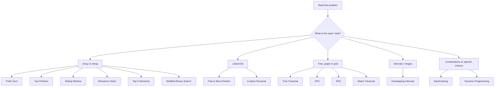

| Pattern | Typical signal from a problem |
|---|---|
| Prefix Sum | Repeated range-sum queries or cumulative totals |
| Two Pointers | Pair search, often in a sorted array |
| Sliding Window | Contiguous subarray or substring |
| Fast & Slow Pointers | Cycle detection |
| Linked List In-place Reversal | Reverse a list or a section without extra space |
| Monotonic Stack | Next greater or next smaller element |
| Top K Elements | Kth largest/smallest or top-K frequency |
| Overlapping Intervals | Merge or process intersecting ranges |
| Modified Binary Search | Search in sorted or rotated data |
| Binary Tree Traversal | Visit nodes in a particular order |
| DFS | Explore a branch deeply before backtracking |
| BFS | Explore level by level; shortest path in an unweighted graph |
| Matrix Traversal | Explore connected cells in a 2D grid |
| Backtracking | Generate or search possible combinations/solutions |
| Dynamic Programming | Overlapping subproblems and optimal substructure |

---

# 1. Prefix Sum

## What it is

Prefix Sum preprocesses an array into another array where each position stores the cumulative sum from the beginning up to that index. This makes range-sum queries efficient.

## When to use it

- When multiple sum queries are performed on subarrays.
- When cumulative sums are needed.

## Sample problem

Given an array `nums`, answer queries asking for the sum of elements in a range `[i, j]`.

**Input**

```text
nums = [1, 2, 3, 4, 5, 6]
i = 1
j = 3
```

**Output**

```text
9
```

## Walkthrough

Original array:

```text
Index:  0  1  2   3   4   5
Value:  1  2  3   4   5   6
```

Prefix sum array:

```text
Index:       0  1  2   3   4   5
Prefix sum:  1  3  6  10  15  21
```

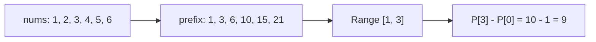

For the source article's example, the range sum is calculated as:

```text
P[j] - P[i - 1]
```

## LeetCode practice

- [303. Range Sum Query - Immutable](https://leetcode.com/problems/range-sum-query-immutable/)
- [525. Contiguous Array](https://leetcode.com/problems/contiguous-array/)
- [560. Subarray Sum Equals K](https://leetcode.com/problems/subarray-sum-equals-k/)

---

# 2. Two Pointers

## What it is

Two Pointers uses two indexes to traverse an array or list. It is often used to find pairs or elements that satisfy a condition.

## When to use it

- When working with sorted arrays or lists.
- When looking for pairs that satisfy a target condition.

## Sample problem

Find two numbers in a sorted array that add up to a target.

**Input**

```text
nums = [1, 2, 3, 4, 6]
target = 6
```

**Output**

```text
[1, 3]
```

## Walkthrough

1. Place `left` at the beginning and `right` at the end.
2. Calculate the sum of the values at both pointers.
3. If the sum equals the target, return the answer.
4. If the sum is smaller, move `left` to the right.
5. If the sum is larger, move `right` to the left.

```text
[1, 2, 3, 4, 6]
 L              R

1 + 6 = 7  → too large; move R left

[1, 2, 3, 4, 6]
 L           R

1 + 4 = 5  → too small; move L right

[1, 2, 3, 4, 6]
    L        R

2 + 4 = 6  → target found
```

## LeetCode practice

- [167. Two Sum II - Input Array Is Sorted](https://leetcode.com/problems/two-sum-ii-input-array-is-sorted/)
- [15. 3Sum](https://leetcode.com/problems/3sum/)
- [11. Container With Most Water](https://leetcode.com/problems/container-with-most-water/)

---

# 3. Sliding Window

## What it is

Sliding Window maintains a window of elements to find a subarray or substring that satisfies a condition. It avoids recalculating everything from scratch as the window moves.

## When to use it

- When the problem involves a contiguous subarray.
- When the problem involves a substring.
- When a window of a fixed or changing size is useful.

## Sample problem

Find the maximum sum of a subarray of size `k`.

**Input**

```text
nums = [2, 1, 5, 1, 3, 2]
k = 3
```

**Output**

```text
9
```

## Walkthrough

1. Calculate the sum of the first `k` elements.
2. Move the window one position at a time.
3. Subtract the element leaving the window.
4. Add the new element entering the window.
5. Keep track of the maximum sum.

```text
Array:  [2, 1, 5, 1, 3, 2]
         └─────┘
         2+1+5 = 8

Array:  [2, 1, 5, 1, 3, 2]
            └─────┘
            1+5+1 = 7

Array:  [2, 1, 5, 1, 3, 2]
               └─────┘
               5+1+3 = 9  ← maximum

Array:  [2, 1, 5, 1, 3, 2]
                  └─────┘
                  1+3+2 = 6
```

## LeetCode practice

- [643. Maximum Average Subarray I](https://leetcode.com/problems/maximum-average-subarray-i/)
- [3. Longest Substring Without Repeating Characters](https://leetcode.com/problems/longest-substring-without-repeating-characters/)
- [76. Minimum Window Substring](https://leetcode.com/problems/minimum-window-substring/)

---

# 4. Fast & Slow Pointers

## What it is

Also called the **Tortoise and Hare** pattern. Two pointers move through a linked list or similar structure at different speeds.

## Sample problem

Detect whether a linked list contains a cycle.

## Walkthrough

1. Initialize `slow` to move one step at a time.
2. Initialize `fast` to move two steps at a time.
3. If a cycle exists, `fast` will eventually meet `slow`.
4. If `fast` reaches the end, there is no cycle.

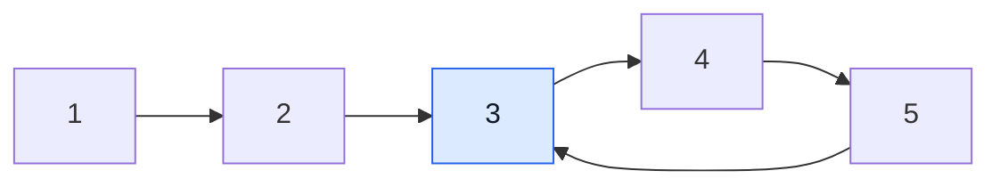

## LeetCode practice

- [141. Linked List Cycle](https://leetcode.com/problems/linked-list-cycle/)
- [202. Happy Number](https://leetcode.com/problems/happy-number/)
- [287. Find the Duplicate Number](https://leetcode.com/problems/find-the-duplicate-number/)

---

# 5. Linked List In-place Reversal

## What it is

This pattern reverses a linked list, or a section of it, by changing pointers rather than creating another list.

## When to use it

When a problem asks you to reverse a linked list or a specific section of one.

## Sample problem

Reverse a linked-list sublist from position `m` to position `n`.

**Input**

```text
head = [1, 2, 3, 4, 5]
m = 2
n = 4
```

**Output**

```text
[1, 4, 3, 2, 5]
```

## Visual walkthrough

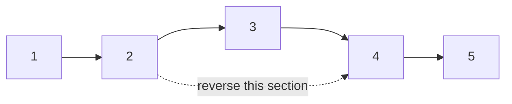

Result:

```text
Before: 1 → 2 → 3 → 4 → 5
After:  1 → 4 → 3 → 2 → 5
```

## Walkthrough

1. Identify the start and end of the sublist.
2. Reverse the nodes in place by adjusting their pointers.

## LeetCode practice

- [206. Reverse Linked List](https://leetcode.com/problems/reverse-linked-list/)
- [92. Reverse Linked List II](https://leetcode.com/problems/reverse-linked-list-ii/)
- [24. Swap Nodes in Pairs](https://leetcode.com/problems/swap-nodes-in-pairs/)

---

# 6. Monotonic Stack

## What it is

A Monotonic Stack maintains elements in a specific order, either increasing or decreasing.

## When to use it

When a problem asks for the next greater or next smaller element.

## Sample problem

Find the next greater element for every element in an array. If no greater element exists, return `-1`.

**Input**

```text
nums = [2, 1, 2, 4, 3]
```

**Output**

```text
[4, 2, 4, -1, -1]
```

## Walkthrough

1. Keep elements in a stack when their next greater element has not yet been found.
2. Iterate through the array.
3. For each current element, pop elements from the stack until the required greater-element condition is met.
4. If the stack is not empty, assign the current element as the next greater element for the index at the top of the stack.
5. Push the current element onto the stack.

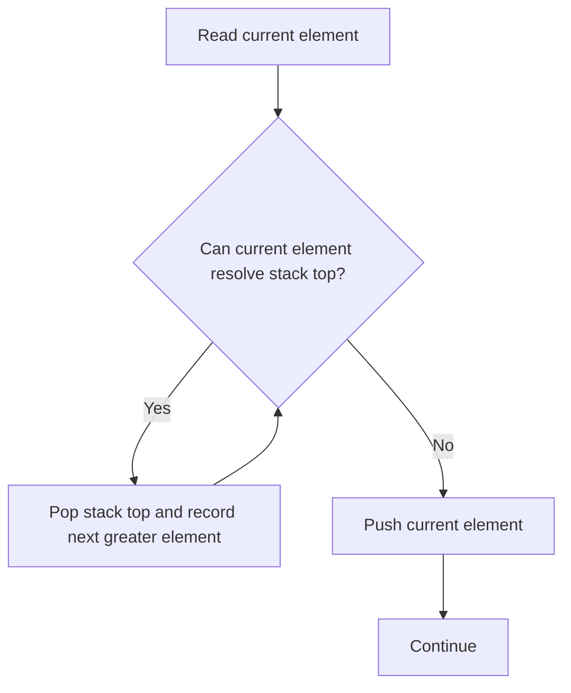

## LeetCode practice

- [496. Next Greater Element I](https://leetcode.com/problems/next-greater-element-i/)
- [739. Daily Temperatures](https://leetcode.com/problems/daily-temperatures/)
- [84. Largest Rectangle in Histogram](https://leetcode.com/problems/largest-rectangle-in-histogram/)

---

# 7. Top K Elements

## What it is

The Top K pattern finds the `k` largest or smallest elements in an array or data stream, commonly using a heap or sorting.

## Sample problem

Find the kth largest element in an unsorted array.

**Input**

```text
nums = [3, 2, 1, 5, 6, 4]
k = 2
```

**Output**

```text
5
```

## Walkthrough

1. Use a min-heap of size `k` to keep the `k` largest elements.
2. Iterate through the array and add elements to the heap.
3. If the heap size exceeds `k`, remove the smallest element.
4. The root of the heap is the kth largest element.

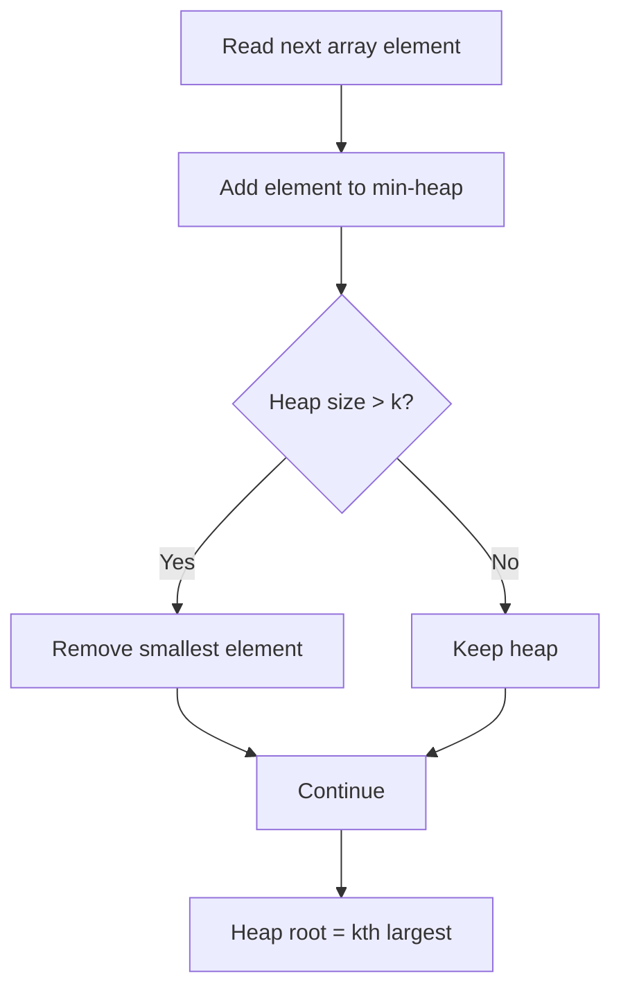

## LeetCode practice

- [215. Kth Largest Element in an Array](https://leetcode.com/problems/kth-largest-element-in-an-array/)
- [347. Top K Frequent Elements](https://leetcode.com/problems/top-k-frequent-elements/)
- [373. Find K Pairs with Smallest Sums](https://leetcode.com/problems/find-k-pairs-with-smallest-sums/)

---

# 8. Overlapping Intervals

## What it is

This pattern merges or processes intervals that overlap.

For intervals `[a, b]` and `[c, d]`, after sorting by start time, they overlap when:

```text
b >= c
```

## Sample problem

Merge all overlapping intervals.

**Input**

```text
[[1, 3], [2, 6], [8, 10], [15, 18]]
```

**Output**

```text
[[1, 6], [8, 10], [15, 18]]
```

## Visual walkthrough

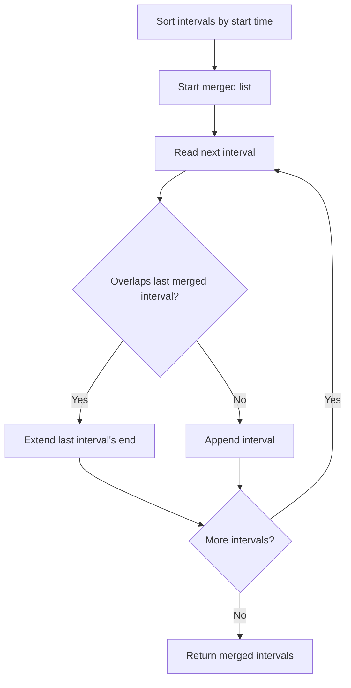

```text
[1────3]
   [2──────6]       → [1────────6]

[8────10]           → [8────10]

[15────18]          → [15────18]
```

## Walkthrough

1. Sort intervals by their start time.
2. Create an empty list named `merged`.
3. Iterate through the intervals and compare each one with the last interval in `merged`.
4. If they overlap, update the end of the last merged interval.
5. Otherwise, append the current interval.

## LeetCode practice

- [56. Merge Intervals](https://leetcode.com/problems/merge-intervals/)
- [57. Insert Interval](https://leetcode.com/problems/insert-interval/)
- [435. Non-overlapping Intervals](https://leetcode.com/problems/non-overlapping-intervals/)

---

# 9. Modified Binary Search

## What it is

Modified Binary Search adapts binary search to solve problems beyond a standard sorted-array search, including searching rotated sorted arrays.

## When to use it

When searching in sorted or rotated arrays.

## Sample problem

Find a target in a rotated sorted array.

**Input**

```text
nums = [4, 5, 6, 7, 0, 1, 2]
target = 0
```

**Output**

```text
4
```

## Walkthrough

1. Perform binary search.
2. Determine which half of the array is sorted.
3. Check whether the target lies within that sorted half.
4. Search the relevant half; otherwise, search the other half.

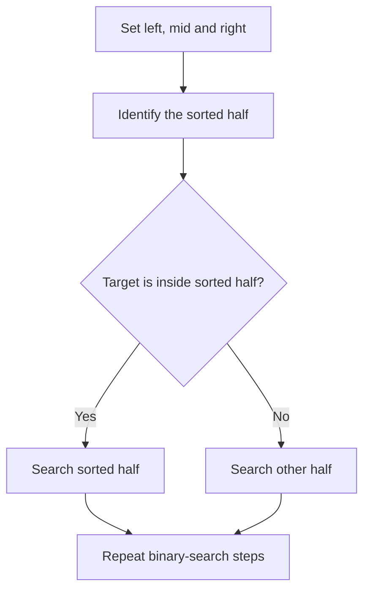

## LeetCode practice

- [33. Search in Rotated Sorted Array](https://leetcode.com/problems/search-in-rotated-sorted-array/)
- [153. Find Minimum in Rotated Sorted Array](https://leetcode.com/problems/find-minimum-in-rotated-sorted-array/)
- [240. Search a 2D Matrix II](https://leetcode.com/problems/search-a-2d-matrix-ii/)

---

# 10. Binary Tree Traversal

## What it is

Binary Tree Traversal means visiting every node in a tree in a defined order.

## Three traversal orders

| Traversal | Order |
|---|---|
| Preorder | Root → Left → Right |
| Inorder | Left → Root → Right |
| Postorder | Left → Right → Root |

## Visual reference

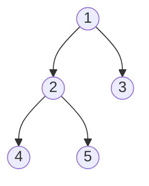

For this tree:

- **Preorder:** 1, 2, 4, 5, 3
- **Inorder:** 4, 2, 5, 1, 3
- **Postorder:** 4, 5, 2, 3, 1

## Sample problem

Perform inorder traversal of a binary tree.

**Input**

```text
root = [1, null, 2, 3]
```

**Output**

```text
[1, 3, 2]
```

## Walkthrough

1. Inorder traversal visits nodes in the order: left, root, right.
2. Use recursion or a stack to perform the traversal.

## LeetCode practice

- Preorder: [257. Binary Tree Paths](https://leetcode.com/problems/binary-tree-paths/)
- Inorder: [230. Kth Smallest Element in a BST](https://leetcode.com/problems/kth-smallest-element-in-a-bst/)
- Postorder: [124. Binary Tree Maximum Path Sum](https://leetcode.com/problems/binary-tree-maximum-path-sum/)

---

# 11. Depth-First Search (DFS)

## What it is

DFS explores as far down a branch as possible before backtracking.

## When to use it

When exploring paths or branches in trees and graphs.

## Sample problem

Find all paths from the root to the leaves of a binary tree.

**Input**

```text
root = [1, 2, 3, null, 5]
```

**Output**

```text
["1->2->5", "1->3"]
```

## Visual reference

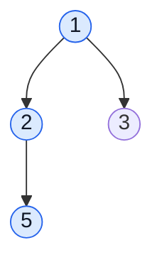

One DFS path is explored deeply before returning to explore another branch.

## Walkthrough

1. Use recursion or a stack to traverse each path from the root to the leaves.
2. Record each path while traversing.

## LeetCode practice

- [133. Clone Graph](https://leetcode.com/problems/clone-graph/)
- [113. Path Sum II](https://leetcode.com/problems/path-sum-ii/)
- [210. Course Schedule II](https://leetcode.com/problems/course-schedule-ii/)

---

# 12. Breadth-First Search (BFS)

## What it is

BFS explores a tree or graph level by level.

## When to use it

- For level-order traversal in trees.
- For finding shortest paths in unweighted graphs.

## Sample problem

Perform level-order traversal of a binary tree.

**Input**

```text
root = [3, 9, 20, null, null, 15, 7]
```

**Output**

```text
[[3], [9, 20], [15, 7]]
```

## Visual reference

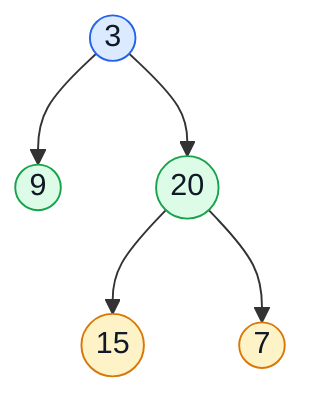

```text
Level 0: [3]
Level 1: [9, 20]
Level 2: [15, 7]
```

## Walkthrough

1. Use a queue to keep track of nodes at each level.
2. Traverse the current level.
3. Add the children of the current nodes to the queue.

## LeetCode practice

- [102. Binary Tree Level Order Traversal](https://leetcode.com/problems/binary-tree-level-order-traversal/)
- [994. Rotting Oranges](https://leetcode.com/problems/rotting-oranges/)
- [127. Word Ladder](https://leetcode.com/problems/word-ladder/)

---

# 13. Matrix Traversal

## What it is

Matrix Traversal visits elements in a 2D matrix using techniques such as DFS or BFS.

## When to use it

When a problem involves traversing a grid horizontally, vertically or diagonally.

## Sample problem

Perform flood fill on a 2D grid. Change all cells connected to the starting cell to a new color.

**Input**

```text
image = [
  [1, 1, 1],
  [1, 1, 0],
  [1, 0, 1]
]
sr = 1
sc = 1
newColor = 2
```

**Output**

```text
[
  [2, 2, 2],
  [2, 2, 0],
  [2, 0, 1]
]
```

## Visual walkthrough

Before:

```text
1 1 1
1 1 0
1 0 1
  ↑
Start at row 1, column 1
```

After flood fill:

```text
2 2 2
2 2 0
2 0 1
```

## Walkthrough

1. Use DFS or BFS to traverse the matrix from the starting cell.
2. Change the color of the connected cells to the new color.

## LeetCode practice

- [733. Flood Fill](https://leetcode.com/problems/flood-fill/)
- [200. Number of Islands](https://leetcode.com/problems/number-of-islands/)
- [130. Surrounded Regions](https://leetcode.com/problems/surrounded-regions/)

---

# 14. Backtracking

## What it is

Backtracking explores possible solutions and returns to an earlier state when a path does not lead to a valid solution.

## When to use it

When you need to find all or some solutions that satisfy constraints, especially in combinatorial problems such as:

- Permutations
- Combinations
- Subsets

## Sample problem

Generate all permutations of a list of numbers.

**Input**

```text
nums = [1, 2, 3]
```

**Output**

```text
[
  [1, 2, 3],
  [1, 3, 2],
  [2, 1, 3],
  [2, 3, 1],
  [3, 1, 2],
  [3, 2, 1]
]
```

## Visual reference

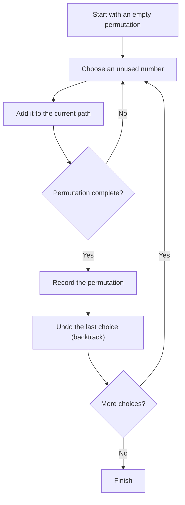

## Walkthrough

1. Use recursion to generate permutations.
2. For each element, include it in the current permutation and recursively generate the remaining permutations.
3. Backtrack when all permutations for a given path have been generated.

## LeetCode practice

- [46. Permutations](https://leetcode.com/problems/permutations/)
- [78. Subsets](https://leetcode.com/problems/subsets/)
- [51. N-Queens](https://leetcode.com/problems/n-queens/)

---

# 15. Dynamic Programming Patterns

## What it is

Dynamic Programming (DP) breaks a problem into smaller subproblems and solves them using either a top-down or bottom-up approach.

## When to use it

When a problem has:

- Overlapping subproblems.
- Optimal substructure.

## Important DP sub-patterns listed in the source

1. Fibonacci Numbers
2. 0/1 Knapsack
3. Longest Common Subsequence (LCS)
4. Longest Increasing Subsequence (LIS)
5. Subset Sum
6. Matrix Chain Multiplication

## Sample problem

Calculate the nth Fibonacci number.

**Input**

```text
n = 5
```

**Output**

```text
5
```

The first Fibonacci numbers are:

```text
0, 1, 1, 2, 3, 5
```

## Walkthrough

1. Use a bottom-up approach.
2. Start with the first two numbers: `0` and `1`.
3. Iterate to calculate the next numbers using:

```text
dp[i] = dp[i - 1] + dp[i - 2]
```

## Visual reference

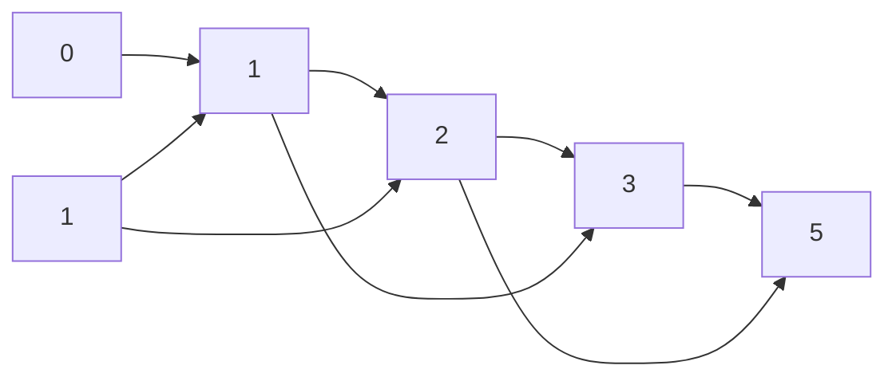

## LeetCode practice

- [70. Climbing Stairs](https://leetcode.com/problems/climbing-stairs/)
- [198. House Robber](https://leetcode.com/problems/house-robber/)
- [322. Coin Change](https://leetcode.com/problems/coin-change/)
- [1143. Longest Common Subsequence](https://leetcode.com/problems/longest-common-subsequence/)
- [300. Longest Increasing Subsequence](https://leetcode.com/problems/longest-increasing-subsequence/)
- [416. Partition Equal Subset Sum](https://leetcode.com/problems/partition-equal-subset-sum/)

**Further reading:** [20 Patterns to Master Dynamic Programming](https://blog.algomaster.io/p/20-patterns-to-master-dynamic-programming)

---

## Practice checklist

Use this checklist to track your progress through the 15 patterns.

- [ ] Prefix Sum
- [ ] Two Pointers
- [ ] Sliding Window
- [ ] Fast & Slow Pointers
- [ ] Linked List In-place Reversal
- [ ] Monotonic Stack
- [ ] Top K Elements
- [ ] Overlapping Intervals
- [ ] Modified Binary Search
- [ ] Binary Tree Traversal
- [ ] Depth-First Search (DFS)
- [ ] Breadth-First Search (BFS)
- [ ] Matrix Traversal
- [ ] Backtracking
- [ ] Dynamic Programming

---

## Source and notes

- **Original article:** [LeetCode was HARD until I Learned these 15 Patterns](https://blog.algomaster.io/p/15-leetcode-patterns)
- **Author:** Ashish Pratap Singh
- **Publication date:** July 21, 2024

**Image note:** The supplied text export did not contain embedded article images or image URLs. To keep this Markdown self-contained and useful, the document includes original Mermaid diagrams and text-based illustrations for the concepts. These are explanatory visuals, not copied screenshots from the original article.
