# Document Processing & RAG Architecture
## Visual Architecture Guide, Technical Deep Dive & Interview Preparation

---

# 1. Understanding the Complete Architecture

Our application implements a document ingestion pipeline for a Retrieval-Augmented Generation (RAG) system.

The main objective is to convert uploaded documents into searchable knowledge.

### Technologies

| Technology | Responsibility |
|---|---|
| FastAPI | Backend API |
| Python | Business logic |
| Google Cloud Storage | Original document storage |
| LangChain | Document processing |
| PyPDFLoader / Docx2txtLoader | Text extraction |
| RecursiveCharacterTextSplitter | Chunking |
| EmbeddingsFactory | Embedding generation |
| VectorStoreFactory | Vector database integration |
| SQLAlchemy | Relational database |
| MongoDB / Vector Store | Vector and chunk storage |
| SHA-256 | Content fingerprinting |

---

# 2. Complete System Architecture

This is the most important diagram. Understand this first.

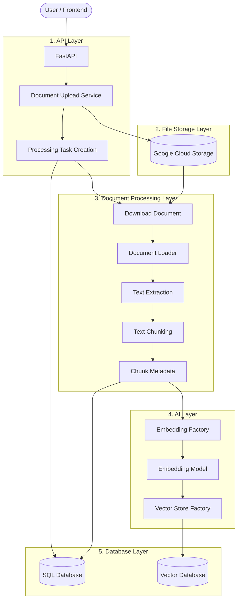

### Understand the five layers

1. **API Layer:** Accepts the document and initiates processing.
2. **Storage Layer:** Stores the original uploaded file.
3. **Processing Layer:** Extracts text and creates chunks.
4. **AI Layer:** Converts chunks into embeddings.
5. **Database Layer:** Stores document metadata and searchable vectors.

### Interview explanation

"Our architecture separates file storage, document processing, AI operations and metadata persistence. This makes the ingestion pipeline modular and easier to scale."

---

# 3. Document Upload Lifecycle

Let's understand what happens when a user uploads a PDF.

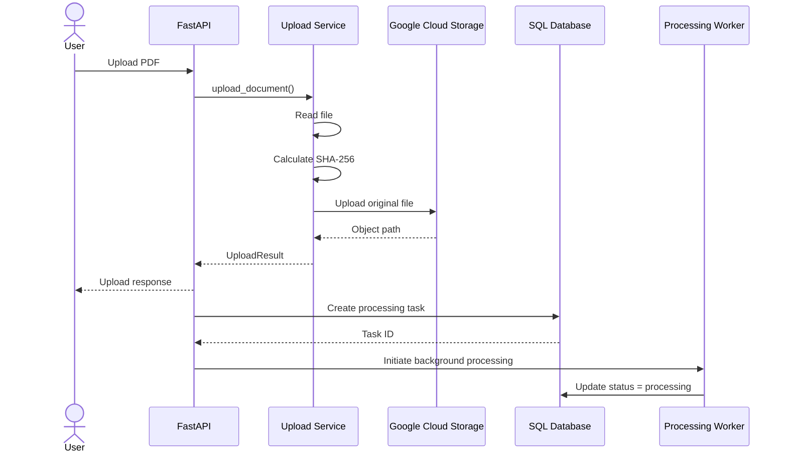

### Example

A user uploads:

`annual_report_2026.pdf`

The application performs:

```text
Original File
     |
     v
Calculate SHA-256
     |
     v
Sanitize Filename
     |
     v
Generate GCS Object Path
     |
     v
Upload to Google Cloud Storage
     |
     v
Return UploadResult
```

Example GCS path:

```text
kb_101/annual_report_2026.pdf
```

**Important:** The code contains the upload function and a background-processing function. The actual API orchestration and scheduling mechanism need to be verified in the wider application.

---

# 4. Google Cloud Storage Architecture

GCS is responsible for storing original documents, not performing semantic searches.

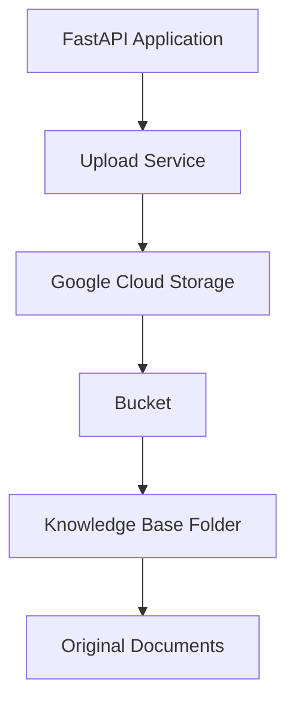

### Example storage structure

```text
GCS Bucket
    |
    |-- kb_101/
    |      |
    |      |-- annual_report.pdf
    |      |-- financial_report.docx
    |      |-- company_policy.txt
    |
    |-- kb_102/
           |
           |-- research_document.pdf
           |-- market_analysis.md
```

### Why GCS?

- Durable object storage.
- Handles large files.
- Separates file storage from backend processing.
- Original documents can be downloaded for reprocessing.

---

# 5. Document Extraction Architecture

Different file formats require different loaders.

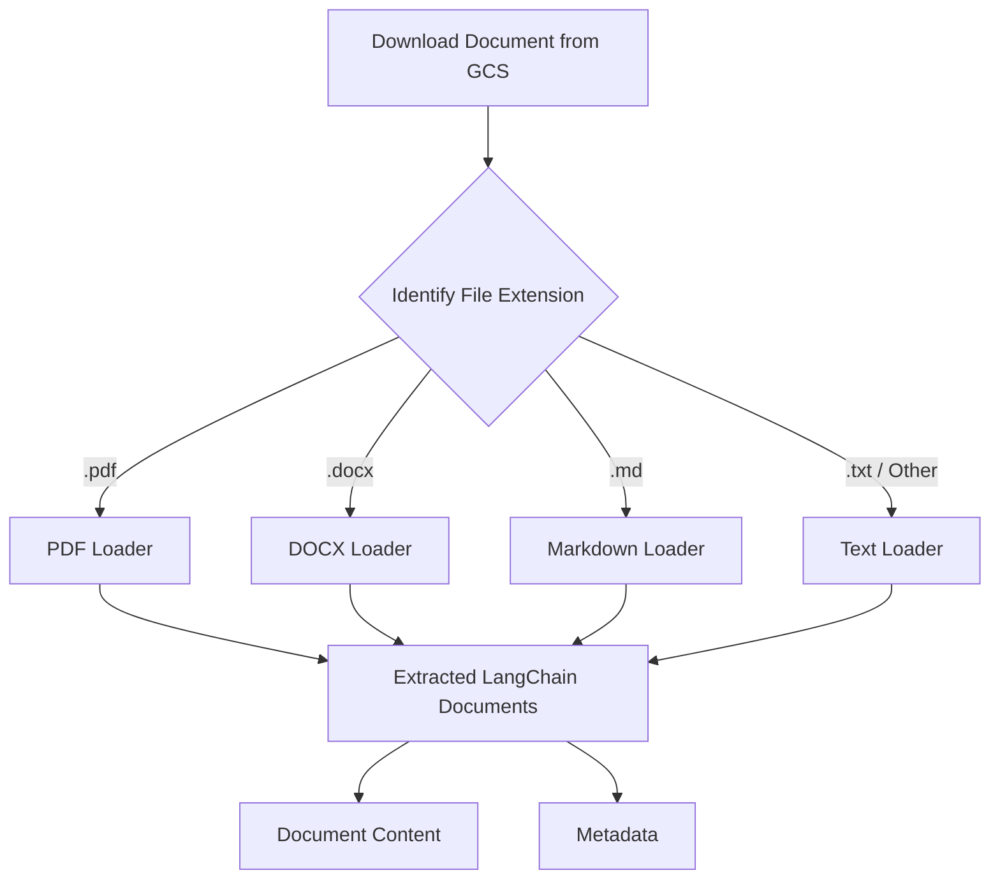

### Loader mapping

| File | Loader |
|---|---|
| PDF | PyPDFLoader |
| DOCX | Docx2txtLoader |
| Markdown | UnstructuredMarkdownLoader |
| TXT | TextLoader |

### What does the loader return?

LangChain uses a Document object.

```python
Document(
    page_content="Company revenue increased by 20%.",
    metadata={
        "source": "annual_report.pdf",
        "page": 5
    }
)
```

There are two important parts:

- `page_content`: Extracted text.
- `metadata`: Information about the original source.

Metadata is important because we need to identify where a retrieved chunk came from.

---

# 6. Document Chunking Architecture

This is one of the most important concepts in RAG.

Imagine an uploaded PDF containing 100 pages.

Sending the entire document to an embedding model is not an ideal approach.

Instead, we divide the document into smaller sections.

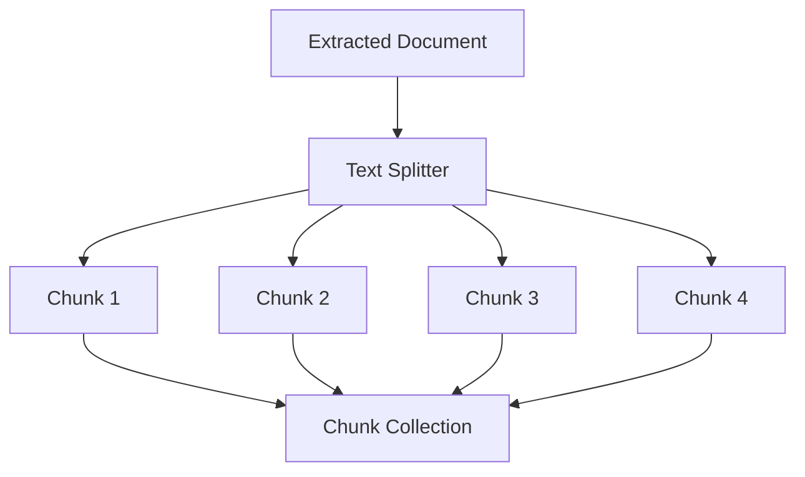

### Understanding chunk size and overlap

Current configuration:

```python
chunk_size = 1000
chunk_overlap = 200
```

Example:

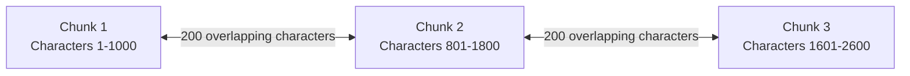

### Why overlap?

Without overlap, information at the end of one chunk might be disconnected from information at the beginning of the next chunk.

Example:

```text
Chunk 1:
The company's annual revenue increased because of

Chunk 2:
strong international sales and customer growth.
```

With overlap, the second chunk can retain some context from the first.

### Chunking trade-offs

| Smaller chunks | Larger chunks |
|---|---|
| More precise retrieval | More surrounding context |
| Less context per result | More context per result |
| More embedding records | Fewer embedding records |
| May fragment information | May introduce irrelevant information |

---

# 7. Embedding Generation Architecture

After chunking, every chunk needs to be converted into a vector.

### What is an embedding?

An embedding is a numerical representation of text.

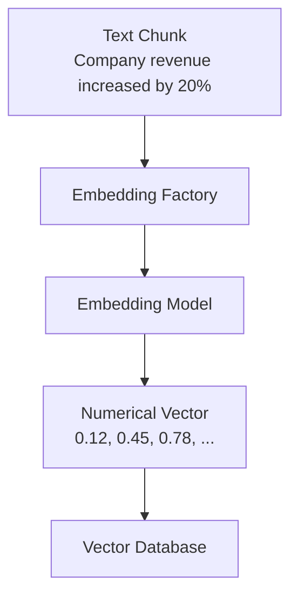

### Example

Input:

```text
Company revenue increased by 20%.
```

Output:

```python
[
    0.123,
    0.456,
    0.789,
    0.234,
    ...
]
```

The actual vector dimension depends on the embedding model configuration.

### Why embeddings?

Consider these two sentences:

```text
Sentence A:
How can a company increase its revenue?

Sentence B:
Strategies for improving business sales.
```

They use different words but have related meanings.

An embedding model represents semantic relationships in vector space.

This enables semantic search instead of relying only on exact keyword matching.

---

# 8. Vector Database Architecture

The vector database stores the chunks and their embeddings for semantic retrieval.

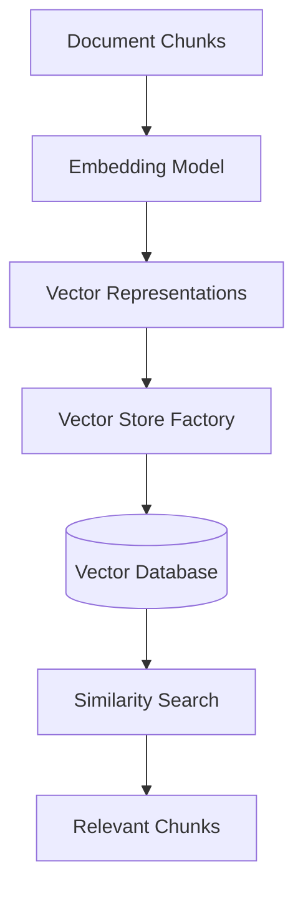

### Example vector record

Conceptually:

```json
{
  "id": "chunk_001",
  "text": "Company revenue increased by 20%.",
  "embedding": [0.12, 0.45, 0.78],
  "metadata": {
    "file_name": "annual_report.pdf",
    "kb_id": 101,
    "document_id": 500
  }
}
```

### What happens during vector search?

1. User submits a query.
2. Query is converted into an embedding.
3. Vector database compares the query vector against stored vectors.
4. Most similar chunks are returned.
5. Retrieved chunks can be supplied to an LLM.

Common similarity methods:

- Cosine similarity.
- Euclidean distance.
- Dot product.

The exact metric depends on the vector store configuration.

---

# 9. Incremental Processing and SHA-256

This is an important optimization implemented in `process_document()`.

Imagine a document has 100 chunks.

The user updates only 5 chunks.

Do we need to regenerate all 100 embeddings?

No. We can identify unchanged chunks using hashes.

### Architecture

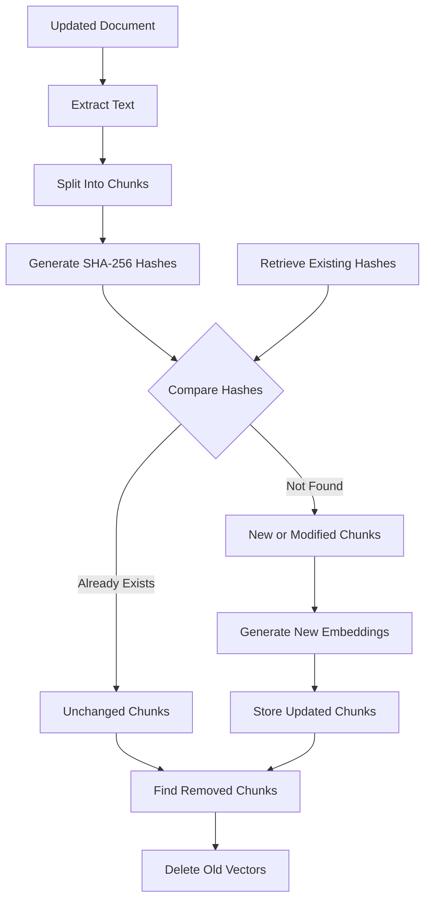

### Understanding SHA-256

Example:

```python
import hashlib

text = "Company revenue increased by 20%"

hash_value = hashlib.sha256(
    text.encode()
).hexdigest()
```

SHA-256 generates a fixed-length 256-bit digest, commonly represented as 64 hexadecimal characters.

### Why deterministic chunk IDs?

The application generates IDs using:

```python
chunk_id = hashlib.sha256(
    f"{kb_id}:{file_name}:{chunk_hash}".encode()
).hexdigest()
```

This makes the ID reproducible for the same knowledge base, filename and chunk hash.

### Interview takeaway

Hash-based incremental processing reduces unnecessary embedding generation and vector database operations.

---

# 10. Background Processing Architecture

Document processing may take seconds or minutes depending on document size and embedding API latency.

We don't want the upload request to wait for the entire operation.

### Architecture

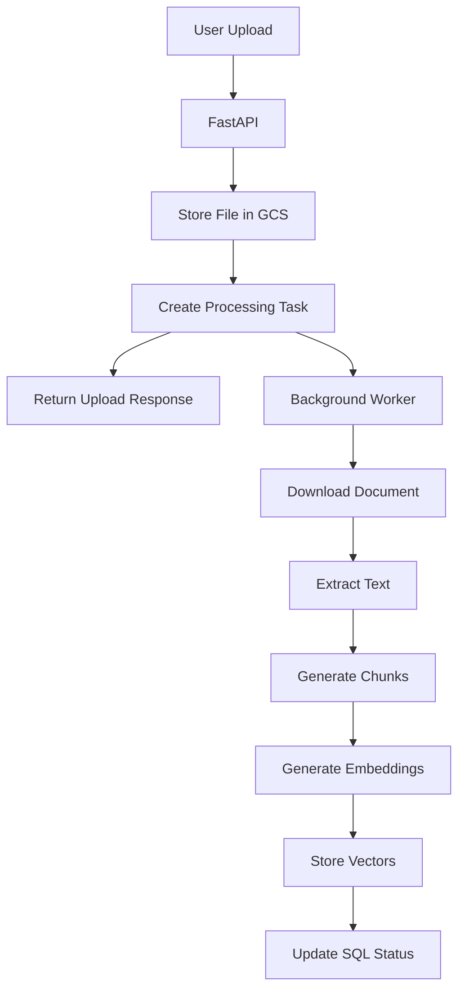

### Processing status lifecycle

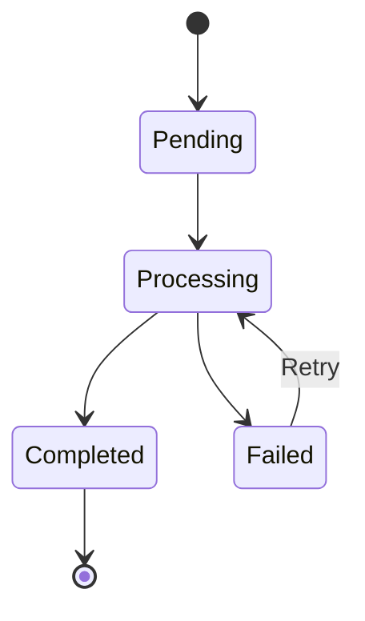

### Why background processing?

- Faster API responses.
- Better scalability.
- Independent processing lifecycle.
- Ability to retry failed operations.
- Better handling of large documents.

**Code observation:** The supplied file implements a background-processing function and task status updates, but does not show a complete durable task queue implementation.

---

# 11. SQL Database vs Vector Database

Understanding this separation is essential for interviews.

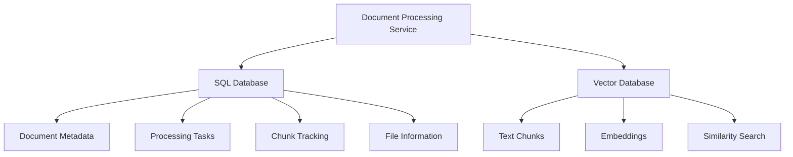

### SQL Database Responsibilities

- KnowledgeBase
- ProcessingTask
- Document
- DocumentChunk
- Processing status
- File metadata
- Chunk hashes

### Vector Database Responsibilities

- Embedding storage.
- Semantic search.
- Similarity matching.
- Retrieval of relevant document chunks.

### Comparison

| Feature | SQL | Vector DB |
|---|---|---|
| Document metadata | Yes | Metadata support |
| Processing status | Yes | Not its primary role |
| Relational queries | Yes | No |
| Embedding storage | Not primary purpose | Yes |
| Similarity search | Not primary purpose | Yes |

---

# 12. Understanding the RAG Query Lifecycle

Document ingestion is only the first half of a RAG application.

The second half is retrieval and answer generation.

The supplied Python file mainly implements ingestion, not the complete query lifecycle.

### RAG architecture

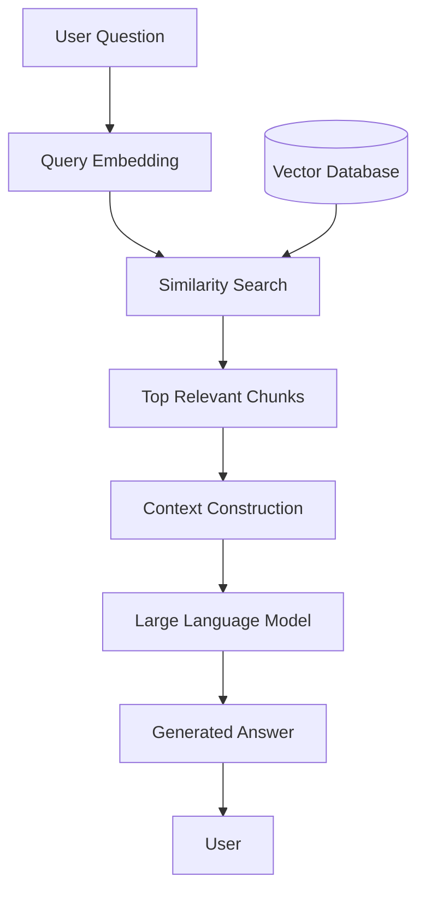

### Example

User asks:

"What was the company's revenue growth?"

The application:

1. Converts the question into an embedding.
2. Searches the vector database.
3. Retrieves relevant chunks from annual reports.
4. Constructs a prompt using the retrieved context.
5. Sends the prompt to an LLM.
6. Returns an answer.

### Important distinction

**Ingestion:** Converts documents into searchable knowledge.

**Retrieval:** Finds relevant knowledge based on a question.

**Generation:** Uses retrieved knowledge to generate a response.

---

# 13. Document Deletion Architecture

A document deletion operation must clean up all associated records.

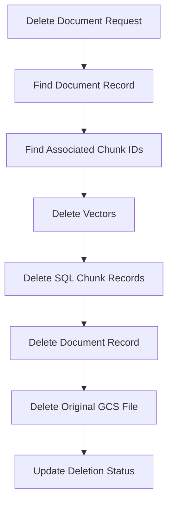

This is a recommended lifecycle design, not a deletion function shown in the supplied source.

### Interview question

What happens if vector deletion succeeds but SQL deletion fails?

Answer:

We need retry-safe deletion, status tracking and reconciliation to ensure both storage systems eventually reach a consistent state.

---

# 14. Failure Handling and Recovery Architecture

Distributed document processing involves multiple external dependencies.

For example:

- GCS might fail.
- Embedding API might return an error.
- MongoDB might become unavailable.
- SQL transactions might fail.

### Recommended recovery flow

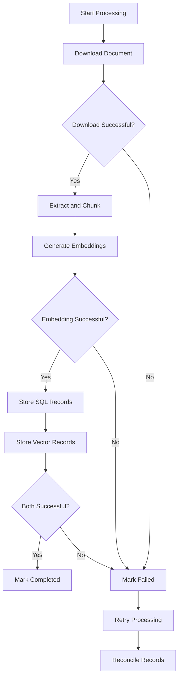

### Important concepts

**Idempotency:** Running the same processing operation again should not create duplicate records.

**Retry:** Temporarily failed operations should be attempted again.

**Reconciliation:** Compare SQL and vector storage to identify missing or outdated records.

**Dead-letter queue:** Permanently failed tasks can be isolated for investigation.

These are recommended production design concepts; the supplied code does not implement all of them.

---

# 15. Multi-Tenant Knowledge Base Architecture

A multi-tenant application must prevent one company's documents from appearing in another company's search results.

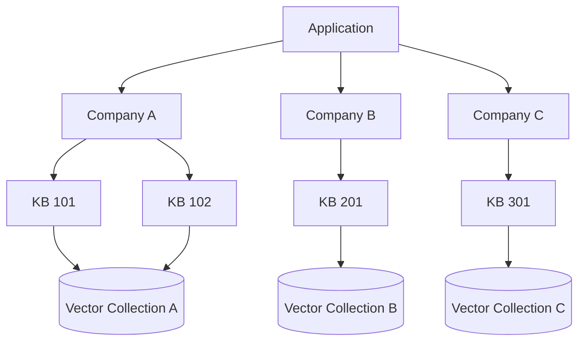

### Important security considerations

- Validate the authenticated user's company.
- Validate knowledge-base ownership.
- Apply tenant filters during retrieval.
- Never trust a user-supplied knowledge-base ID without authorization checks.
- Ensure document IDs cannot be used to access another tenant's documents.

The uploaded code includes KB and company identifiers in metadata, but the full authorization and isolation implementation is outside this file.

---

# 16. Important Code Architecture

The supplied code uses factory and service abstractions.

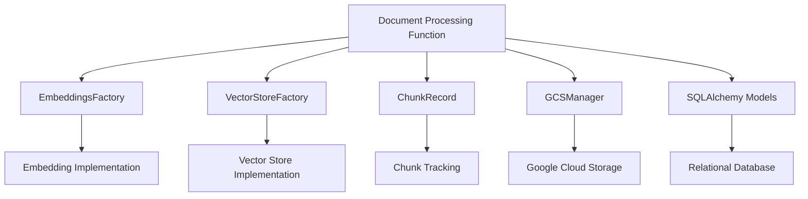

### Factory Pattern

The application does not directly initialize every implementation throughout the code.

Instead:

```python
embeddings = EmbeddingsFactory.create()
```

And:

```python
vector_store = VectorStoreFactory.create(
    store_type=settings.VECTOR_STORE_TYPE,
    collection_name=f"kb_{kb_id}",
    embedding_function=embeddings
)
```

Benefits:

- Loose coupling.
- Easier testing.
- Centralized initialization.
- Ability to change implementations.

---

# 17. Architecture Issues to Understand Before Interview

The uploaded source has two different document-processing implementations.

| Area | `process_document()` | `process_document_background()` |
|---|---|---|
| Vector store | Configured by settings | Hardcoded as mongo |
| Collection | `kb_{kb_id}` | `kb_{CIN}` |
| Chunk tracking | ChunkRecord | DocumentChunk model |
| Processing | Preview-based | Direct loader processing |
| GCS path | Object path | Parsed URL |
| Document record | Not created here | Created in SQL |

Be ready to explain why these differences exist in the wider application.

### Additional improvements

1. Use one consistent document-processing pipeline.
2. Standardize GCS object paths.
3. Avoid blocking synchronous I/O inside async request handlers.
4. Add streaming for large uploads.
5. Implement durable background task execution.
6. Add idempotent writes to both databases.
7. Implement automatic retries.
8. Add structured logging and metrics.
9. Improve temporary-file cleanup.
10. Add document versioning.

---

# 18. Interview Questions

## Architecture

1. Explain the complete document ingestion architecture.
2. Why do we use GCS?
3. Why do we use LangChain?
4. What is the role of EmbeddingsFactory?
5. What is the role of VectorStoreFactory?
6. Why separate SQL and vector databases?

## RAG and AI

7. What is RAG?
8. What is an embedding?
9. What is cosine similarity?
10. Why do we need chunking?
11. What is chunk overlap?
12. What is semantic search?
13. How does vector retrieval work?
14. How do you improve retrieval accuracy?

## Database

15. How does SHA-256 help in deduplication?
16. What is a deterministic ID?
17. How do you handle document updates?
18. How do you prevent duplicate embeddings?
19. How do you maintain consistency across SQL and MongoDB?
20. How would you implement document versioning?

## Python and Backend

21. Why use FastAPI async functions?
22. What is the difference between synchronous and asynchronous execution?
23. What is a factory design pattern?
24. What is dependency injection?
25. Why use temporary files?
26. Why is the finally block important?
27. How do you handle exceptions in background processing?

## System Design

28. Design a scalable document ingestion system.
29. How would you process 10,000 documents simultaneously?
30. How would you handle failed embedding requests?
31. How would you implement retry mechanisms?
32. How would you design a multi-tenant RAG platform?
33. How would you prevent cross-company data leakage?
34. How would you monitor embedding costs?
35. How would you handle millions of vector records?

---

# 19. Final Architecture Mental Model

Remember this sequence:

```text
UPLOAD
   |
   v
GCS STORAGE
   |
   v
DOWNLOAD
   |
   v
DOCUMENT EXTRACTION
   |
   v
TEXT CHUNKING
   |
   v
HASH COMPARISON
   |
   v
EMBEDDING GENERATION
   |
   v
VECTOR DATABASE
   |
   v
SEMANTIC RETRIEVAL
   |
   v
LLM GENERATION
   |
   v
FINAL ANSWER
```

### The five concepts you should be able to explain on a whiteboard

1. How a document travels from FastAPI to GCS.
2. How document loaders extract text and chunking divides it.
3. How embeddings convert text into vectors.
4. How SQL and vector databases work together.
5. How RAG retrieves relevant information and generates an answer.

**Final interview tip:** Don't just memorize the diagram. Be able to explain why every component exists, what data it receives, what it produces, and what happens when it fails.

That is what demonstrates real architectural understanding.