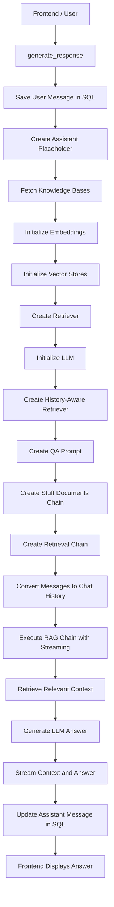
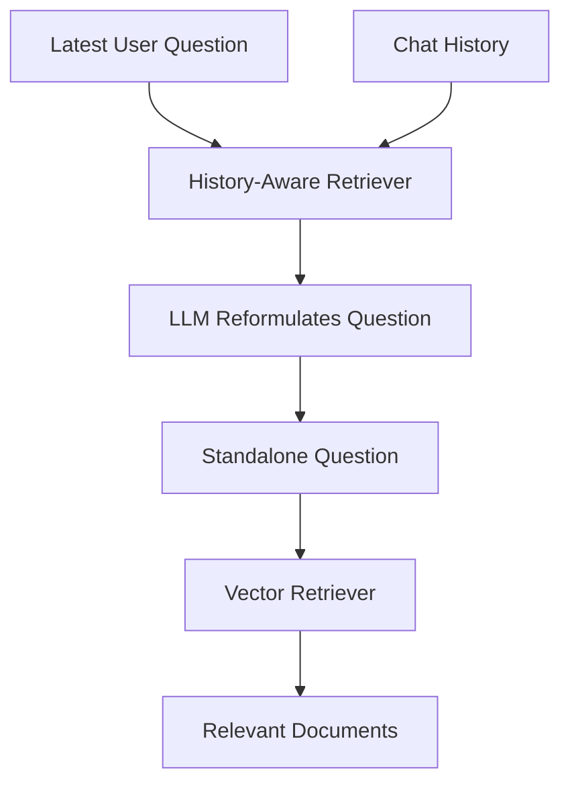
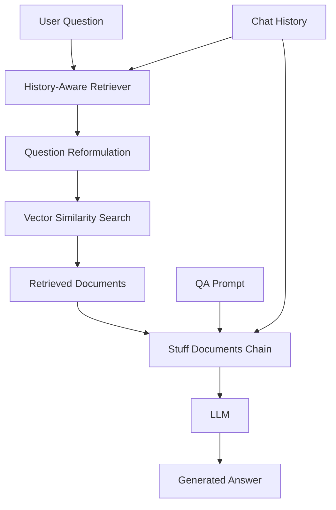
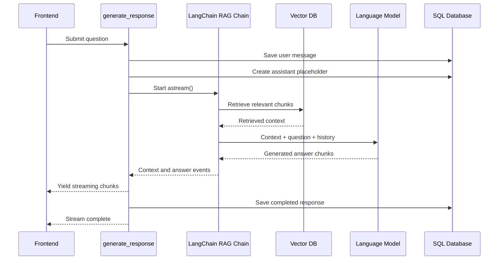

# RAG Chat Architecture – Understanding, Implementation & Interview Preparation

## 1. Introduction

This module implements a Retrieval-Augmented Generation (RAG) chat pipeline using:

- FastAPI-compatible asynchronous response generation
- LangChain
- MongoDB vector store
- OpenAI-compatible embedding integration
- LLM integration through `LLMFactory`
- SQLAlchemy for chat and message persistence
- Conversation history for contextual question understanding
- Streaming responses to the frontend

The main function is:

```python
async def generate_response(
    query: str,
    messages: dict,
    knowledge_base_ids: List[int],
    chat_id: int,
    db: Session
) -> AsyncGenerator[str, None]:
```

Its responsibility is to take a user's question, retrieve relevant document information, provide that information to an LLM, generate an answer, stream the answer to the frontend, and save the conversation in the database.

### High-level objective

The system should allow users to ask questions about their uploaded documents while maintaining conversational context.

For example:

User: What was the company's revenue in 2025?

Assistant: The company's revenue was ₹500 crore.

User: How much did it grow compared to the previous year?

The system should understand that "it" refers to the company's revenue and retrieve the relevant information before generating the answer.

---

# 2. Complete Architecture

## 2.1 Whiteboard architecture diagram



## 2.2 Architecture components

| Component | Responsibility |
|---|---|
| Frontend | Sends user query and displays streamed response |
| `generate_response()` | Orchestrates the complete RAG pipeline |
| SQLAlchemy | Stores chat messages and fetches knowledge-base records |
| `EmbeddingsFactory` | Creates the embedding model |
| `VectorStoreFactory` | Initializes the MongoDB vector store |
| Retriever | Searches for relevant document chunks |
| `LLMFactory` | Creates the language model |
| History-aware retriever | Reformulates questions using chat history |
| QA prompt | Defines how the LLM should generate answers |
| Stuff documents chain | Combines retrieved documents into the prompt |
| Retrieval chain | Connects retrieval and answer generation |
| Async streaming | Sends response chunks incrementally |

---

# 3. Detailed Execution Flow

## Step 1: Receive the user's question

The function receives five parameters:

```python
async def generate_response(
    query: str,
    messages: dict,
    knowledge_base_ids: List[int],
    chat_id: int,
    db: Session
):
```

Explanation:

- `query`: The latest question from the user.
- `messages`: Previous conversation history.
- `knowledge_base_ids`: Knowledge bases selected for the current conversation.
- `chat_id`: Identifies the current chat session.
- `db`: SQLAlchemy database session.

Example:

```python
query = "What was the company's revenue growth?"

knowledge_base_ids = [101, 102]

chat_id = 5001
```

The selected knowledge bases determine which knowledge-base records are considered during vector-store initialization.

## Step 2: Save the user's message in SQL

```python
user_message = Message(
    content=query,
    role="user",
    chat_id=chat_id
)

db.add(user_message)
db.commit()
```

The user's question is persisted before retrieval begins.

Example database record:

| Field | Value |
|---|---|
| chat_id | 5001 |
| role | user |
| content | What was the company's revenue growth? |

Why do this?

- Maintain conversation history.
- Persist user messages.
- Support chat history retrieval.
- Maintain a record of the conversation.

## Step 3: Create an assistant placeholder

```python
bot_message = Message(
    content="",
    role="assistant",
    chat_id=chat_id
)

db.add(bot_message)
db.commit()
```

An empty assistant message is created before generation begins.

Once the response has been generated, this record is updated with the generated content.

The advantage is that an assistant message record already exists while generation is in progress.

## Step 4: Fetch the selected knowledge bases

```python
knowledge_bases = (
    db.query(KnowledgeBase)
    .filter(
        KnowledgeBase.id.in_(knowledge_base_ids)
    )
    .all()
)
```

The system fetches knowledge-base records using the IDs supplied by the caller.

For example:

```text
knowledge_base_ids = [101, 102]
```

The database may return:

```text
Knowledge Base 101
Knowledge Base 102
```

The next stage uses these records to initialize vector stores.

Important distinction: Fetching a knowledge-base record does not itself retrieve its document chunks.

## Step 5: Initialize the embedding model

```python
embeddings = EmbeddingsFactory.create()
```

The embedding model converts text into numerical vectors.

It is needed for semantic similarity search.

For example:

```text
User question:
"What was the revenue growth?"
```

The embedding model converts the question into a vector representation.

The vector database compares that query representation against the vectors generated during document ingestion.

Important: The query embedding model must be compatible with the model used to generate document embeddings.

## Step 6: Initialize the vector store

```python
vector_stores = []

for kb in knowledge_bases:

    documents = (
        db.query(Document)
        .filter(
            Document.knowledge_base_id == kb.id
        )
        .all()
    )

    if documents:

        vector_store = VectorStoreFactory.create(
            store_type="mongo",
            collection_name="knowledge_base",
            embedding_function=embeddings,
        )

        vector_stores.append(vector_store)
```

This stage checks whether each selected knowledge base has document records.

If documents exist, the code initializes a MongoDB-backed vector store.

### Why use a vector store?

A vector store provides:

- Embedding storage.
- Similarity search.
- Retrieval of relevant document chunks.
- Metadata-based filtering, when configured.

### Important implementation observation

Every vector store is initialized with the same collection name:

```python
collection_name="knowledge_base"
```

Also, the code later uses only:

```python
retriever = vector_stores[0].as_retriever()
```

Therefore, the current implementation does not actually combine the retrievers for all selected knowledge bases.

Although multiple vector-store objects may be initialized, the retrieval pipeline uses only the first one.

This is an important point to understand before explaining multi-knowledge-base retrieval in an interview.

## Step 7: Handle the empty knowledge-base scenario

```python
if not vector_stores:

    error_msg = (
        "I don't have any knowledge base "
        "to help answer your question."
    )

    yield f'0:"{error_msg}"\n'

    yield (
        'd:{"finishReason":"stop",'
        '"usage":{"promptTokens":0,'
        '"completionTokens":0}}\n'
    )

    bot_message.content = error_msg
    db.commit()

    return
```

If no usable vector store is available, the function:

1. Generates an explanatory message.
2. Streams the message to the frontend.
3. Updates the assistant message in SQL.
4. Stops further processing.

This prevents the LLM from attempting document-based answering without an available knowledge base.

## Step 8: Create the retriever

```python
retriever = vector_stores[0].as_retriever()
```

A retriever is an abstraction that searches the vector store for relevant documents.

For example:

```text
User question:
"What was the company's revenue growth?"
```

The retriever searches for relevant chunks such as:

```text
Chunk 1:
The company's revenue increased by 20% in 2025.

Chunk 2:
The company reported revenue of ₹500 crore.
```

The code also executes:

```python
retrieved_docs = retriever.invoke(query)
```

This performs a direct retrieval using the original question.

However, the result is only logged and is not passed to the later chain.

The subsequent `rag_chain.astream()` performs its own retrieval through the history-aware retriever. Therefore, this direct retrieval is redundant in the current implementation and may create an unnecessary vector-search operation.

## Step 9: Initialize the LLM

```python
llm = LLMFactory.create()
```

The LLM is responsible for generating the final natural-language answer.

The factory pattern separates model creation from the RAG orchestration logic.

Benefits:

- Centralized model configuration.
- Easier model replacement.
- Cleaner architecture.
- Easier support for different LLM providers.

The exact model, provider, temperature, and token settings depend on the implementation of `LLMFactory`, which is not included in this code.

---

# 4. History-Aware Retrieval

This is one of the most important parts of the implementation.

## 4.1 Why do we need conversation history?

Consider this conversation:

User: What is the company's revenue?

Assistant: The revenue was ₹500 crore.

User: What about its profit?

The latest question is ambiguous when considered independently.

The system needs to understand that "its" refers to the company discussed earlier.

This is where history-aware retrieval helps.

## 4.2 Contextualization prompt

```python
contextualize_q_system_prompt = (
    "Given a chat history and the latest user question "
    "which might reference context in the chat history, "
    "formulate a standalone question which can be understood "
    "without the chat history. Do NOT answer the question, just "
    "reformulate it if needed and otherwise return it as is."
)
```

The prompt instructs the LLM to rewrite a context-dependent question into a standalone question.

Example:

```text
Chat history:
User: What is the company's revenue?
Assistant: The revenue was ₹500 crore.

Latest question:
What about its profit?
```

Reformulated question:

```text
What was the company's profit?
```

Notice that the LLM is not answering the question at this stage.

It is only reformulating it.

## 4.3 Build the contextualization prompt

```python
contextualize_q_prompt = ChatPromptTemplate.from_messages([
    ("system", contextualize_q_system_prompt),
    MessagesPlaceholder("chat_history"),
    ("human", "{input}")
])
```

Components:

- `system`: Instructions for question reformulation.
- `MessagesPlaceholder`: Inserts previous conversation messages.
- `human`: Inserts the latest user question.

## 4.4 Create the history-aware retriever

```python
history_aware_retriever = (
    create_history_aware_retriever(
        llm,
        retriever,
        contextualize_q_prompt
    )
)
```

Conceptually:



How it works:

1. Receives the latest question.
2. Checks the supplied chat history.
3. Uses the LLM to reformulate the question when necessary.
4. Sends the standalone question to the retriever.
5. Returns relevant documents.

When no chat history is provided, the history-aware retriever can pass the original question directly to the underlying retriever.

---

# 5. Answer Generation Using Stuff Documents Chain

Once relevant documents have been retrieved, the system needs to generate an answer using their content.

## 5.1 QA system prompt

The implementation defines instructions such as:

- Answer accurately and concisely.
- Use the supplied context.
- Cite relevant contexts using `[citation:x]`.
- Avoid unrelated information.
- Do not blindly repeat document content.
- State when information is missing.
- Respond in the same language as the question, apart from code and specific names.

This prompt controls the LLM's answer-generation behavior.

## 5.2 Create the QA prompt

```python
qa_prompt = ChatPromptTemplate.from_messages([
    ("system", qa_system_prompt),
    MessagesPlaceholder("chat_history"),
    ("human", "{input}")
])
```

This prompt includes:

1. System-level answer instructions.
2. Previous conversation history.
3. The latest user question.

The `{context}` variable in the system prompt is populated by the document-combination chain.

## 5.3 Document prompt

```python
document_prompt = PromptTemplate.from_template(
    "\n\n- {page_content}\n\n"
)
```

This controls how each retrieved document is formatted before being inserted into the final prompt.

The current template includes only `page_content`, not the document metadata.

## 5.4 Create the Stuff Documents Chain

```python
question_answer_chain = (
    create_stuff_documents_chain(
        llm,
        qa_prompt,
        document_variable_name="context",
        document_prompt=document_prompt
    )
)
```

### What is Stuff Documents Chain?

It combines all retrieved documents into a single context and passes that context to the LLM.

Example:

```text
Retrieved Chunk 1:
Revenue increased by 20%.

Retrieved Chunk 2:
The company reported ₹500 crore revenue.

Retrieved Chunk 3:
The previous year's revenue was ₹416.67 crore.
```

The chain combines them:

```text
Context:

Revenue increased by 20%.

The company reported ₹500 crore revenue.

The previous year's revenue was ₹416.67 crore.
```

This context is then supplied to the LLM.

### Why is it called Stuff?

Because the retrieved documents are placed together into one prompt rather than being independently summarized or processed in multiple LLM calls.

Advantages:

- Simple implementation.
- Easy to understand.
- Good for a manageable number of retrieved chunks.

Limitations:

- Prompt token usage increases with context size.
- Large contexts may exceed the model's context window.
- Irrelevant chunks can reduce answer quality.

---

# 6. Create the Complete Retrieval Chain

```python
rag_chain = create_retrieval_chain(
    history_aware_retriever,
    question_answer_chain,
)
```

This connects the two major stages:

1. Retrieval: Find relevant documents using the history-aware retriever.
2. Generation: Pass the retrieved documents into the Stuff Documents Chain.

### Complete RAG chain



The chain is responsible for coordinating retrieval and generation.

The `create_retrieval_chain()` output includes the retrieved context and generated answer, which the code consumes during streaming.

---

# 7. Processing Conversation History

The code converts the frontend-provided message history into LangChain message objects.

```python
chat_history = []

for message in messages["messages"]:

    if message["role"] == "user":

        chat_history.append(
            HumanMessage(content=message["content"])
        )

    elif message["role"] == "assistant":

        if "__LLM_RESPONSE__" in message["content"]:

            message["content"] = (
                message["content"]
                .split("__LLM_RESPONSE__")[-1]
            )

        chat_history.append(
            AIMessage(content=message["content"])
        )
```

Why convert the messages?

LangChain prompts expect compatible message objects.

The implementation uses:

| Message type | Purpose |
|---|---|
| `HumanMessage` | Previous user messages |
| `AIMessage` | Previous assistant messages |
| `MessagesPlaceholder` | Inserts the history into the prompt |

The code also removes the context portion before `__LLM_RESPONSE__` from assistant messages, intending to keep the previous AI answer in the chat history.

Important implementation consideration: This modifies the dictionaries in the supplied `messages` object directly. Copying the message content into a local variable would avoid unexpected mutation of caller-owned data.

---

# 8. Streaming the LLM Response

This is another important part of the architecture.

Instead of waiting for the entire answer to finish, the code streams output incrementally.

```python
async for chunk in rag_chain.astream({
    "input": query,
    "chat_history": chat_history
}):
```

The `astream()` method allows the application to consume the chain's output as it becomes available.

## 8.1 Context streaming

```python
if "context" in chunk:

    serializable_context = []

    for context in chunk["context"]:

        serializable_doc = {
            "page_content": context.page_content.replace(
                '"', '\\"'
            ),
            "metadata": context.metadata,
        }

        serializable_context.append(serializable_doc)

    escaped_context = json.dumps({
        "context": serializable_context
    })

    base64_context = (
        base64.b64encode(
            escaped_context.encode()
        ).decode()
    )

    separator = "__LLM_RESPONSE__"

    yield f'0:"{base64_context}{separator}"\n'
```

What happens here?

1. Retrieves the context documents from the chain output.
2. Extracts page content and metadata.
3. Converts them into a JSON-compatible structure.
4. Encodes the JSON using Base64.
5. Adds a separator.
6. Sends the context as a stream event.

Why Base64?

It provides a text representation of the serialized context, which can be useful when transporting structured content through a text-based streaming protocol.

Base64 is encoding, not encryption. It does not protect confidential information.

## 8.2 Answer streaming

```python
if "answer" in chunk:

    answer_chunk = chunk["answer"]

    full_response += answer_chunk

    escaped_chunk = (
        answer_chunk
        .replace('"', '\\"')
        .replace('\n', '\\n')
    )

    yield f'0:"{escaped_chunk}"\n'
```

Each answer fragment is:

1. Read from the chain output.
2. Added to the accumulated response.
3. Escaped for the output format.
4. Yielded to the frontend.

The frontend can display the response incrementally rather than waiting for the complete answer.

## 8.3 Streaming architecture diagram



Note: This diagram represents the intended logical streaming flow. The exact timing of context and answer events depends on the LangChain chain's streaming behavior.

---

# 9. Persisting the Final Assistant Response

```python
bot_message.content = full_response
db.commit()
```

Once the streaming loop completes, the accumulated response is saved in SQL.

The stored content contains:

- Base64-encoded context data.
- The `__LLM_RESPONSE__` separator.
- The generated answer text.

This design allows the application to retain both the context information and answer in one message field.

However, storing structured context and answer data separately would generally be easier to query, maintain, and display.

---

# 10. Exception Handling and Database Cleanup

The code uses:

```python
except Exception as e:

    error_message = (
        f"Error generating response: {str(e)}"
    )

    yield f'3:"{error_message}"\n'

    if 'bot_message' in locals():

        bot_message.content = error_message
        db.commit()

finally:
    db.close()
```

### Exception handling

If an exception occurs:

1. An error message is created.
2. An error event is yielded to the frontend.
3. The assistant message is updated if its object exists.
4. The database transaction is committed.

### Finally block

The database session is closed regardless of whether the operation succeeds or fails.

Important consideration: The caller may own the SQLAlchemy session. Closing a caller-owned session inside a service function can create lifecycle problems. A cleaner approach is to define clear session ownership, normally at the request or dependency-management layer.

---

# 11. Important Implementation Observations and Improvements

These are particularly useful for senior-level interviews because they show that you understand not just how the code works, but also its limitations.

| Area | Current implementation | Potential improvement |
|---|---|---|
| Multiple knowledge bases | Creates multiple vector-store objects but uses only the first retriever | Combine retrievers or use one shared retriever with mandatory KB filters |
| Collection naming | Uses `knowledge_base` for every store | Define an intentional collection and tenant/KB partitioning strategy |
| Retrieval filtering | No explicit KB metadata filter is shown | Apply mandatory knowledge-base and tenant filters |
| Duplicate retrieval | Calls `retriever.invoke(query)` and later runs the RAG chain | Remove the unused direct retrieval |
| Retrieval parameters | Uses `as_retriever()` without explicit search configuration | Configure `k`, search type and metadata filters |
| Prompt metadata | Document prompt includes only `page_content` | Include source name, page number and document identifiers where needed |
| Citation grounding | Requests positional citations `[citation:x]` | Pass stable source identifiers and validate citations |
| Context window | Uses Stuff Documents Chain | Limit context, deduplicate chunks, rerank or use map-reduce for larger contexts |
| Conversation history | Uses the supplied history without visible length management | Apply a sliding window or history summarization |
| Message persistence | Stores encoded context and answer in one field | Store answer and retrieved source records separately |
| Error handling | Catches general exceptions | Classify errors and use structured logging, retries and safe client-facing errors |
| Database session | Closes `db` inside the generator | Make session ownership explicit |
| Debug logging | Enables verbose and debug globally | Use environment-based logging levels |
| Access control | Does not show chat ownership or KB permission checks | Validate user ownership and authorization before retrieval |

## 11.1 Most important: Multiple knowledge-base retrieval issue

Consider:

```python
for kb in knowledge_bases:
    ...
    vector_stores.append(vector_store)
```

But later:

```python
retriever = vector_stores[0].as_retriever()
```

This means only the first vector store is used.

If a user selects three knowledge bases, the current implementation does not guarantee retrieval across all three.

A better design would be:

**Option A: Shared collection with metadata filtering**

```python
retriever = vector_store.as_retriever(
    search_kwargs={
        "k": 5,
        "filter": {
            "kb_id": {
                "$in": knowledge_base_ids
            }
        }
    }
)
```

The exact filter syntax depends on the vector-store integration and its supported MongoDB filtering behavior.

**Option B: Multiple retrievers**

Create a retriever for each selected knowledge base, retrieve results from each, merge the results, deduplicate them and rank the final collection.

In either approach, validate that the user is authorized to access every selected knowledge base.

## 11.2 Citation limitation

The system prompt asks the LLM to cite context using:

```text
[citation:1]
[citation:2]
```

However, the document prompt only includes:

```python
"{page_content}"
```

The source metadata is not included in the prompt.

Therefore, the model is being asked to cite chunks by their positions, but it is not given explicit source names or page numbers through that document template.

For more reliable citations, I would include a stable source identifier, filename, page number and chunk ID in the prompt, then validate the generated citations against the retrieved documents.

## 11.3 Streaming and partial persistence

The assistant placeholder is committed before generation. The final response is committed after streaming finishes.

If the stream fails midway, the exception handler attempts to save the error message rather than the partial answer.

A more robust design would maintain explicit statuses such as:

- pending
- generating
- completed
- failed

It should also define whether partial responses are retained or discarded.

---

# 12. Important LangChain Concepts to Understand

| Concept | Explanation |
|---|---|
| `ChatPromptTemplate` | Builds structured prompts from system and human messages |
| `MessagesPlaceholder` | Inserts conversation history into a prompt |
| `HumanMessage` | Represents a user message |
| `AIMessage` | Represents an assistant message |
| `as_retriever()` | Converts a vector store into a retriever |
| `invoke()` | Executes a chain or retriever synchronously |
| `astream()` | Streams chain output asynchronously |
| `create_history_aware_retriever()` | Uses chat history to reformulate a question before retrieval |
| `create_stuff_documents_chain()` | Combines retrieved documents into one prompt context |
| `create_retrieval_chain()` | Connects retrieval and answer generation |
| `LLMFactory` | Centralizes LLM initialization |
| `EmbeddingsFactory` | Centralizes embedding initialization |

---

# 13. Possible Interview Questions and Answers

## Section A – Architecture and RAG fundamentals

### Q1. Explain the complete architecture of your RAG chat system.

**Answer:**

"When a user sends a question, we first persist it in SQL and create an assistant placeholder. We fetch the selected knowledge bases and initialize the embedding model and MongoDB vector store. We then create a retriever and initialize the LLM.

The history-aware retriever uses the previous conversation to reformulate context-dependent questions. It retrieves relevant document chunks from the vector database. The Stuff Documents Chain combines the retrieved content with our QA prompt, and the LLM generates the answer.

We stream the retrieved context and answer back to the frontend and finally persist the accumulated response in SQL."

### Q2. What is RAG?

RAG stands for Retrieval-Augmented Generation.

It combines information retrieval with LLM generation.

Instead of asking the LLM to answer only from its training knowledge, we retrieve relevant external information and supply it as context.

### Q3. Why do we need a vector database?

A vector database stores embeddings and supports similarity-based retrieval.

It helps find information based on semantic meaning rather than relying only on exact keyword matches.

### Q4. What is the difference between an LLM and an embedding model?

An embedding model converts text into numerical vectors for semantic comparison.

An LLM generates natural-language responses, summarizes content, reasons over supplied context and can reformulate questions.

They perform different responsibilities in the RAG pipeline.

### Q5. What is the role of `LLMFactory` and `EmbeddingsFactory`?

They implement factory-style initialization.

Instead of directly creating model clients throughout the application, we centralize their creation and configuration.

This makes model replacement, configuration management and testing easier.

---

## Section B – Retrieval and conversation history

### Q6. What is a history-aware retriever?

A history-aware retriever uses previous conversation messages to understand the latest question.

It reformulates ambiguous or context-dependent questions into standalone questions before performing vector retrieval.

### Q7. Why do we need question reformulation?

Consider:

```text
User: What is the company's revenue?
Assistant: ₹500 crore.

User: What about its profit?
```

The latest question is incomplete by itself.

Reformulation produces:

```text
What was the company's profit?
```

This gives the retriever a more meaningful search query.

### Q8. Does the history-aware retriever always call the LLM?

Not necessarily.

When there is no chat history, the standard LangChain history-aware retriever can pass the original input directly to the underlying retriever.

When history is available, it uses the contextualization prompt and LLM to generate a standalone question.

### Q9. What is the difference between a retriever and a vector store?

A vector store handles vector persistence and similarity-search operations.

A retriever is an abstraction that exposes a document-retrieval interface.

A vector store can be converted into a retriever using `as_retriever()`.

### Q10. What is top-K retrieval?

Top-K retrieval returns the K most relevant results from a search.

For example, K=5 requests five relevant document chunks.

The number should be tuned according to retrieval quality, context-window size and token cost.

### Q11. What is semantic search?

Semantic search retrieves information based on meaning.

For example, a search for "sales growth" might retrieve a document that says "revenue increased."

The exact words are different, but the concepts are related.

---

## Section C – LangChain chains and prompts

### Q12. What is `create_history_aware_retriever()`?

It creates a retriever that can use conversation history to contextualize the latest user question before retrieving documents.

### Q13. What is `create_stuff_documents_chain()`?

It combines multiple retrieved documents into one context and sends that context to the LLM through a configured prompt.

### Q14. Why is it called Stuff Documents Chain?

Because all retrieved document content is placed together into one prompt.

It is straightforward but can become expensive or exceed the model's context limit when too many documents are retrieved.

### Q15. What is `create_retrieval_chain()`?

It connects a retriever and a document-combination chain.

The retriever supplies relevant documents, and the document-combination chain uses them to generate the answer.

### Q16. What is the purpose of `MessagesPlaceholder`?

It inserts conversation history into the prompt dynamically.

This allows the model to understand previous user and assistant messages without manually concatenating them into one string.

### Q17. What is the difference between `invoke()` and `astream()`?

`invoke()` executes a chain or retriever and returns its result after execution.

`astream()` exposes asynchronous streaming output, allowing the application to consume generated results incrementally.

---

## Section D – Streaming and response handling

### Q18. Why do we use streaming instead of waiting for the complete LLM response?

Streaming improves perceived responsiveness.

Users can start reading the response before the model finishes generating it.

It is particularly useful for longer responses and interactive chat applications.

### Q19. What is an AsyncGenerator?

An asynchronous generator is a function that uses `async def` and `yield`.

It can produce values incrementally while allowing asynchronous operations.

In our implementation, `generate_response()` yields response events to the caller as the RAG chain generates its output.

### Q20. Why do we use Base64 encoding?

We serialize retrieved context into JSON and encode it using Base64.

This gives us a text-safe representation of structured context data to send through our streaming format.

Base64 is not encryption and should not be treated as a security mechanism.

### Q21. Why do we use `__LLM_RESPONSE__`?

It acts as a separator between the encoded retrieved-context payload and the generated assistant answer in the stored message representation.

It also allows the history-processing code to isolate the answer portion.

A structured storage format would be safer and easier to maintain than relying on a separator inside one text field.

### Q22. How does the frontend receive streamed responses?

The backend yields individual response events.

The frontend consumes the streaming response and processes each event according to the agreed protocol.

The exact frontend parsing implementation is outside the provided backend function.

---

## Section E – Database and reliability

### Q23. Why do we store the user message before generating the answer?

It preserves the conversation even if generation later fails.

It also provides a record of the user's request and allows the application to create an assistant placeholder.

### Q24. Why do we create an empty assistant message?

It gives the system a persistent record to update after generation completes.

It can also support message lifecycle tracking when expanded with explicit statuses.

### Q25. What happens if the LLM API fails?

The exception handler catches the error, yields an error event, and attempts to update the assistant message with an error description.

A production implementation should classify errors, avoid exposing sensitive internal details, and apply retry policies to transient failures.

### Q26. What happens if MongoDB retrieval fails?

The current broad exception handler catches the exception and reports a response-generation error.

A more robust implementation would distinguish connection errors, timeouts, invalid filters and missing collections, with appropriate retry or fallback behavior.

### Q27. Why do we call `db.close()` in `finally`?

To ensure cleanup regardless of whether generation succeeds or fails.

However, the service should not close a database session owned by another layer unless session ownership is explicitly part of its contract.

---

## Section F – Senior-level architecture questions

### Q28. How would you support multiple knowledge bases in this architecture?

I would use either:

1. A shared vector collection with mandatory metadata filters for the selected knowledge-base IDs.
2. Separate retrievers for each knowledge base, followed by result merging, deduplication and ranking.

I would also validate access permissions before retrieval.

In the current code, only the first initialized vector store is used, so multi-KB retrieval needs improvement.

### Q29. How would you prevent one company from retrieving another company's data?

I would enforce tenant isolation at multiple layers:

- Authenticate the user.
- Validate access to the selected knowledge bases.
- Derive tenant identity from trusted authentication context.
- Apply mandatory tenant and knowledge-base filters to vector retrieval.
- Validate the metadata of retrieved chunks before sending them to the LLM.
- Test for cross-tenant access and retrieval leakage.

### Q30. What if the retrieved documents are irrelevant?

I would improve retrieval using:

- Better chunking.
- Appropriate embedding models.
- Hybrid keyword and vector search.
- Metadata filters.
- Query rewriting.
- Reranking.
- Retrieval evaluation.

I would also ensure the model can indicate when the available context does not contain an answer.

### Q31. How would you improve citation accuracy?

I would include stable source metadata such as:

- Document ID.
- Filename.
- Page number.
- Chunk ID.

I would pass this information into the prompt and validate citations against the retrieved chunks.

The current positional citation instruction alone does not guarantee correct source attribution.

### Q32. How would you handle a large number of retrieved chunks?

I would:

1. Retrieve an initial candidate set.
2. Filter or rerank the candidates.
3. Deduplicate overlapping chunks.
4. Select the most relevant chunks.
5. Limit the context according to the model's token budget.

For very large contexts, I would evaluate map-reduce or hierarchical retrieval approaches.

### Q33. How would you reduce LLM cost?

I would consider:

- Limiting unnecessary conversation history.
- Reducing irrelevant retrieved context.
- Using a smaller model for query reformulation.
- Caching repeated queries where appropriate.
- Avoiding redundant retrieval.
- Monitoring prompt and completion token usage.

The current code performs a direct retrieval before the RAG chain, even though the result is unused. Removing that operation would avoid unnecessary search work.

### Q34. How would you improve the performance of this pipeline?

I would look at:

- Vector-search latency.
- Embedding initialization and reuse.
- LLM time to first token.
- Retrieval quality and candidate count.
- Prompt token size.
- Database commit frequency.
- Streaming overhead.

I would measure each stage before making optimizations.

### Q35. How would you handle conversation history becoming very large?

I would use a sliding history window or summarize older messages.

I would retain recent messages in full and preserve important long-term context in a structured summary.

This keeps prompts manageable while retaining conversational continuity.

---

# 14. Important Code Review Questions

An interviewer may show you your own implementation and ask what you would change.

Be prepared to discuss these points:

1. Why is `retriever.invoke(query)` executed if the result is not used?
2. Why are multiple vector stores created when only the first retriever is selected?
3. How do you guarantee that only the selected knowledge bases are searched?
4. How do you ensure tenant isolation?
5. Why is metadata not included in the document prompt?
6. How do you guarantee citation correctness?
7. What happens if the LLM fails halfway through streaming?
8. Why do you store context and answer in the same database field?
9. Should a service function close a database session provided by its caller?
10. Why are global debug and verbose logging enabled in application code?

These questions are especially useful for demonstrating practical engineering judgment.

---

# 15. Five-Minute Interview Explanation

If the interviewer asks you to explain the architecture, you can use this answer:

"Our application implements a Retrieval-Augmented Generation pipeline using FastAPI, LangChain, MongoDB and SQLAlchemy.

When a user sends a question, we first store it in our SQL database and create a placeholder for the assistant response. We then fetch the selected knowledge bases and initialize our embedding model and MongoDB vector store.

Next, we create a retriever. We also use a history-aware retriever, which takes the conversation history and the latest question and reformulates it into a standalone question when required.

The retriever performs semantic search and finds relevant document chunks. We pass these chunks to a Stuff Documents Chain, which combines them with our QA prompt.

The LLM then generates the answer using the retrieved context and conversation history.

We execute the complete RAG chain asynchronously using `astream()`. This allows us to stream the retrieved context and generated answer to the frontend incrementally.

Finally, we accumulate the response and persist it in our SQL database.

The main benefit is that the LLM can answer questions using relevant information from our private knowledge bases while maintaining conversational context."

---

# 16. Final Revision Cheat Sheet

| Topic | Remember this |
|---|---|
| `generate_response()` | Main RAG orchestration function |
| SQLAlchemy | Chat messages and knowledge-base records |
| `EmbeddingsFactory` | Initializes the embedding model |
| `VectorStoreFactory` | Creates MongoDB vector-store integration |
| `as_retriever()` | Creates a retriever from the vector store |
| `create_history_aware_retriever()` | Reformulates questions using history |
| `ChatPromptTemplate` | Creates structured prompts |
| `MessagesPlaceholder` | Inserts conversation history |
| `create_stuff_documents_chain()` | Combines retrieved documents into context |
| `create_retrieval_chain()` | Connects retrieval and answer generation |
| `LLMFactory` | Initializes the LLM |
| `astream()` | Streams chain output asynchronously |
| `AsyncGenerator` | Yields results incrementally |
| Base64 | Encodes structured context into text |
| `__LLM_RESPONSE__` | Separates stored context from answer |
| `db.commit()` | Persists database changes |

## The five concepts to master

1. **Retriever:** How relevant document chunks are found.
2. **History-aware retrieval:** How previous messages help interpret the latest question.
3. **Stuff Documents Chain:** How retrieved documents are combined for the LLM.
4. **RAG chain:** How retrieval and answer generation work together.
5. **Streaming:** How the generated answer is delivered incrementally to the frontend.

Remember to distinguish between what the code currently implements and what you would improve in production. That distinction is important in a senior-level interview.


These are the **five most important concepts to master from your RAG chat-generation code**. For a senior-level interview, don't just explain what each component does. Explain how the components interact, why they are needed, what your code currently implements, and what you would change for production.

# **1. Retriever – Finding relevant document chunks**

**What it does:** A retriever finds document chunks that are semantically relevant to a user's question.

Think of it as a search engine for your knowledge base.

### **How it works**

**User query**

"What is the company's revenue growth?"

**Embedding model**

Converts query into a numerical vector

**Vector database**

Searches for semantically similar chunks

**Retrieved documents**

Top-K relevant chunks

### **Your code implementation**

```
retriever = vector_stores[0].as_retriever()retrieved_docs = retriever.invoke(query)
```

Here:

- `as_retriever()` converts the vector store into a LangChain retriever.
- `invoke(query)` searches for relevant documents.
- `retrieved_docs` contains the matching document chunks.

**Important observation:** Your code creates multiple vector stores but uses only `vector_stores[0]`. Also, the result of `retriever.invoke(query)` is not used later. The RAG chain performs retrieval again.

### **Production improvements**

- Configure `search_kwargs`, such as `k=5`.
- Apply mandatory knowledge-base and tenant filters.
- Consider similarity thresholds.
- Use hybrid search (keyword + vector search).
- Add a reranker to improve relevance.

### **Interview-ready answer**

"A retriever is responsible for fetching relevant document chunks from a knowledge base based on a user query. In our implementation, we convert the vector store into a LangChain retriever using `as_retriever()`. The retriever performs semantic search and returns relevant documents. In production, I would add metadata filtering, configurable top-K retrieval, hybrid search and reranking to improve relevance and enforce access control."

# **2. History-aware retrieval – Understanding conversation context**

**What it does:** It makes sure the system understands follow-up questions by considering previous messages.

Consider this conversation:

**User:** What is Tesla's revenue in 2025?

**Assistant:** Tesla reported its 2025 revenue as described in the available documents.

**User:** What about its profit?

**WITHOUT HISTORY**

"What about its profit?" — ambiguous question.

**WITH HISTORY**

"What was Tesla's profit in 2025?" — standalone question.

### **Your code implementation**

```
contextualize_q_prompt = ChatPromptTemplate.from_messages([    ("system", contextualize_q_system_prompt),    MessagesPlaceholder("chat_history"),    ("human", "{input}")])history_aware_retriever = create_history_aware_retriever(    llm,    retriever,    contextualize_q_prompt)
```

The important function is:

```
create_history_aware_retriever()
```

It connects:

1. The LLM.
2. The retriever.
3. The contextualization prompt.

**Execution logic:**

- If chat history exists, the LLM rewrites the latest question into a standalone question.
- The rewritten question is passed to the retriever.
- If there is no chat history, the original question is passed directly to the retriever.

### **Production improvements**

- Limit conversation history to relevant messages.
- Summarize older conversations.
- Avoid sending unnecessary history to the LLM.
- Preserve important entities, dates and constraints during rewriting.
- Measure whether query rewriting improves retrieval quality.

### **Interview-ready answer**

"History-aware retrieval helps the RAG system understand conversational follow-ups. For example, if a user asks 'What about its profit?', the system uses previous messages to understand which company and year the user is referring to. In our implementation, LangChain's `create_history_aware_retriever` uses an LLM and a contextualization prompt to rewrite the question before retrieval."

# **3. Stuff Documents Chain – Combining retrieved documents**

**What it does:** It combines retrieved document chunks into a context that is passed to the LLM.

Imagine retrieval returns three chunks:

- Chunk 1: Revenue information.
- Chunk 2: Profit information.
- Chunk 3: Business performance information.

The Stuff Documents Chain combines these chunks into one context.

## **Stuff Documents Chain**

**Chunk 1**

Revenue

**Chunk 2**

Profit

**Chunk 3**

Performance

**Combined context**

All retrieved document contents are combined.

**LLM**

Generates an answer using the supplied context.

### **Your code implementation**

```
question_answer_chain = create_stuff_documents_chain(    llm,    qa_prompt,    document_variable_name="context",    document_prompt=document_prompt)
```

Your document prompt:

```
document_prompt = PromptTemplate.from_template(    "\n\n- {page_content}\n\n")
```

This means the chain:

1. Receives retrieved documents.
2. Extracts their `page_content`.
3. Combines their contents.
4. Places the combined text into the `{context}` variable.
5. Sends the prompt to the LLM.

### **Why is it called Stuff?**

Because it stuffs all retrieved documents into one prompt.

### **Production improvements**

The biggest limitation is context-window consumption.

For example, if retrieval returns 20 chunks, each containing 1,000 tokens, the LLM receives approximately 20,000 tokens of document context, before accounting for the prompt and conversation history.

Production alternatives:

| Strategy   | Purpose                                                  |
| ---------- | -------------------------------------------------------- |
| Stuff      | Combine all documents directly                           |
| Map Reduce | Process documents separately, then combine summaries     |
| Refine     | Iteratively improve an answer using additional documents |
| Reranking  | Select the most relevant chunks before combining         |

Also, your document prompt includes only `page_content`, not source metadata. I would include document ID, filename and page number to support reliable citations.

### **Interview-ready answer**

"Stuff Documents Chain combines all retrieved document chunks into a single context and passes that context to the LLM. We use LangChain's `create_stuff_documents_chain`. It is simple and works well when the retrieved context is small. For larger knowledge bases, I would consider reranking, context compression or Map Reduce to manage token consumption."

# **4. RAG Chain – Connecting retrieval and answer generation**

**What it does:** It connects the retrieval process with the answer-generation process.

Your implementation has two important components:

- History-aware retriever.
- Stuff Documents Chain.

These are connected through `create_retrieval_chain()`.

### **Your code implementation**

```
rag_chain = create_retrieval_chain(    history_aware_retriever,    question_answer_chain)
```

### **Complete execution flow**

**1**

**User query**

Latest question and chat history

**2**

**History-aware retriever**

Rewrites the question when necessary

**3**

**Vector retrieval**

Finds relevant document chunks

**4**

**Stuff Documents Chain**

Combines retrieved context

**5**

**LLM**

Generates a grounded response

**6**

**Answer**

Returns the generated response

### **How your code streams the RAG chain**

```
async for chunk in rag_chain.astream({    "input": query,    "chat_history": chat_history}):    if "context" in chunk:        # Handle retrieved documents    if "answer" in chunk:        # Handle generated answer
```

Notice that the chain returns different types of information during execution:

- `context`: retrieved documents.
- `answer`: generated answer content.

### **Production improvements**

- Enforce tenant and knowledge-base authorization before retrieval.
- Add reranking and relevance thresholds.
- Add source-aware citations.
- Implement timeouts and retries.
- Monitor retrieval quality and answer quality separately.
- Handle cases where retrieval returns no useful documents.

### **Interview-ready answer**

"A RAG chain orchestrates retrieval and generation. In our implementation, `create_retrieval_chain` connects the history-aware retriever with the Stuff Documents Chain. First, the retriever finds relevant documents, then the document chain supplies the context to the LLM, which generates the final answer."

# **5. Streaming – Delivering responses incrementally**

**What it does:** Instead of waiting for the entire LLM response, streaming delivers generated content in smaller pieces as it becomes available.

### **Without streaming**

Traditional response

**User sends question**

0 sec

Waiting for the complete response...

3 sec

Complete answer received

### **With streaming**

Streaming response

The answer appears progressively

Tesla reported strong revenue growth in 2025...

Its profitability was influenced by operating costs...

The overall performance indicates...

Generating response

### **Your code implementation**

```
async for chunk in rag_chain.astream({    "input": query,    "chat_history": chat_history}):    if "context" in chunk:        # Serialize and encode context    if "answer" in chunk:        answer_chunk = chunk["answer"]        full_response += answer_chunk        # Yield answer fragment to frontend
```

Your code also uses:

```
yield f'0:"{answer_chunk}"\n'
```

This is part of your application's streaming output protocol.

You also encode retrieved context using:

```
base64_context = base64.b64encode(    json.dumps(context_data).encode()).decode()
```

**Important:** Base64 is encoding, not encryption. It does not protect sensitive information.

### **Production improvements**

- Use a well-defined streaming protocol such as Server-Sent Events (SSE).
- Handle client disconnects and cancellation.
- Add heartbeat and completion/error events.
- Persist partial responses safely.
- Avoid storing context and answer together in one unstructured database field.
- Track time-to-first-token and total response latency.
- Avoid exposing internal exception details to frontend users.

### **Interview-ready answer**

"Streaming allows us to deliver LLM-generated responses incrementally instead of waiting for the complete response. In our implementation, we use LangChain's asynchronous `astream()` method and yield response fragments as they arrive. We also stream retrieved context separately. In production, I would use a clearly defined SSE or WebSocket protocol, handle disconnects and cancellation, and track streaming latency."

# **Senior-level comparison: Current implementation vs production**

This is probably the most important table to revise before your interview.

| Concept                 | Current code                           | Production improvement                             |
| ----------------------- | -------------------------------------- | -------------------------------------------------- |
| Retriever               | Uses first vector store only           | Multi-KB retrieval and metadata filters            |
| History-aware retrieval | LLM rewrites follow-up queries         | History summarization and token limits             |
| Stuff Documents Chain   | Combines retrieved page content        | Context compression and reranking                  |
| RAG chain               | Connects retrieval and generation      | Authorization, evaluation and observability        |
| Streaming               | Uses async generator and custom events | SSE/WebSocket, cancellation and robust persistence |

## **10 senior-level interview questions**

Try answering these without looking at the explanations.

**Mock interview**

1 / 10

## **What is the difference between a vector store and a retriever?**

Show hint

Evaluate my answer

Previous

Next question&#x20;

## **My recommended revision order**

1. **Retriever:** Understand vector search, top-K, similarity, metadata filters.
2. **History-aware retrieval:** Understand query rewriting and chat history.
3. **Stuff Documents Chain:** Understand context construction and token limitations.
4. **RAG chain:** Explain the complete architecture without looking at code.
5. **Streaming:** Explain async generators, `astream()`, yielding chunks and frontend delivery.

**One important senior-level point:** Be honest about the current implementation. Your code does not yet demonstrate proper multi-knowledge-base retrieval, explicit tenant filtering, validated citations or production-grade stream cancellation. Explaining these limitations and proposing practical improvements will make your answers stronger than simply describing LangChain functions.